# hl-news-bot

> 一个在 Hyperliquid 永续合约上做新闻事件交易的 Python bot。新闻的采集和判断交给 **NewsLiquid**（6551 OpenNews）：它聚合约 85 个来源，给每条新闻打 0–100 的 AI 影响分和多空方向，并对每个相关币种单独打分；bot 不读标题，只按评分、来源策略和事件模板决定开不开仓。定时宏观数据（BLS 的 CPI、非农）和 Hyperliquid 新上币仍由 bot 自己从一手源直采。过风控闸后按模板开仓，止损挂在交易所、止盈和时间止损在本地。默认 **paper 模式**：真实新闻、真实价格、模拟成交，不碰钱。

这份 README 分两部分。**第一部分是运行手册**：每一条新闻进来之后发生了什么、为什么是这样设计、哪个参数管哪件事、出了问题去哪看。**第二部分是 2026-10-01 的架构设计与可行性结论**：延迟预算、实证数据、事件模板的来源、最小资金、以及对"200% 年化"这个问题的数学回答；其中信息层（自建爬虫 + 规则/LLM 分类）已在 2026-10-28 被 NewsLiquid 取代，见第 15 节。第二部分同时以独立文件保存在 [`docs/HL-news-bot-design.md`](docs/HL-news-bot-design.md)。想先看全貌，直接看[第 0 节的五张图](#0-总览流程图与架构)：总流程、信息来源、注册与接入、决策流程和模块架构。

---

## 目录

**第一部分：运行手册**

0. [总览：流程图与架构](#0-总览流程图与架构)
   - 0.1 [总流程：从注册到平仓](#01-总流程从注册到平仓)
   - 0.2 [信息从哪来](#02-信息从哪来)
   - 0.3 [注册与接入 NewsLiquid](#03-注册与接入-newsliquid)
   - 0.4 [一条新闻怎么变成一笔交易](#04-一条新闻怎么变成一笔交易)
   - 0.5 [模块架构](#05-模块架构)
1. [这套系统在赌什么](#1-这套系统在赌什么)
2. [十分钟跑起来](#2-十分钟跑起来)
3. [一条新闻的完整生命周期](#3-一条新闻的完整生命周期)
4. [模块逐个讲](#4-模块逐个讲)
   - 4.1 [models.py：五个数据类型](#41-modelspy五个数据类型)
   - 4.2 [newsliquid.py 与 feeds.py：新闻从哪来](#42-newsliquidpy-与-feedspy新闻从哪来)
   - 4.3 [macro.py：定时宏观数据的直采](#43-macropy定时宏观数据的直采)
   - 4.4 [classify.py：评分到判断](#44-classifypy评分到判断)
   - 4.5 [engine.py：主循环、去重、门槛、二源佐证、持仓管理](#45-enginepy主循环去重门槛二源佐证持仓管理)
   - 4.6 [risk.py：风控闸与仓位计算](#46-riskpy风控闸与仓位计算)
   - 4.7 [hl.py：行情、滑点估计、paper 与 live 执行](#47-hlpy行情滑点估计paper-与-live-执行)
   - 4.8 [store.py：SQLite 里有什么](#48-storepysqlite-里有什么)
   - 4.9 [backtest.py：事件回测器](#49-backtestpy事件回测器)
   - 4.10 [run.py：入口与命令行](#410-runpy入口与命令行)
5. [config.yaml 逐项解释](#5-configyaml-逐项解释)
6. [事件模板：每一类为什么是这些数字](#6-事件模板每一类为什么是这些数字)
7. [并发模型：几个协程怎么协作](#7-并发模型几个协程怎么协作)
8. [日志怎么读、数据库怎么查](#8-日志怎么读数据库怎么查)
9. [从 paper 到 live 的三道门](#9-从-paper-到-live-的三道门)
10. [Hyperliquid 的几个坑，以及代码里对应的处理](#10-hyperliquid-的几个坑以及代码里对应的处理)
11. [怎么改：调门槛、改来源、加模板、加一手数据源](#11-怎么改调门槛改来源加模板加一手数据源)
12. [已知限制与未做的事](#12-已知限制与未做的事)
13. [常见问题](#13-常见问题)
14. [可视化控制台与 macOS 客户端](#14-可视化控制台与-macos-客户端)
15. [NewsLiquid：接入、套餐与额度、迁移说明](#15-newsliquid接入套餐与额度迁移说明)

**第二部分：架构设计与可行性结论**

- [B0. 先说结论](#b0-先说结论)
- [B1. 目标、边界与边际来源](#b1-目标边界与边际来源)
- [B2. 证据：新闻之后价格多快走完](#b2-证据新闻之后价格多快走完)
- [B3. 信息流分层与延迟预算](#b3-信息流分层与延迟预算)
- [B4. 总体架构](#b4-总体架构)
- [B5. 事件类与交易模板](#b5-事件类与交易模板)
- [B6. 风控：参数之外的部分](#b6-风控参数之外的部分)
- [B7. Hyperliquid 执行细节](#b7-hyperliquid-执行细节)
- [B8. 最小账户金额](#b8-最小账户金额)
- [B9. 关于"公开、已验证、年化 200%+"的方案](#b9-关于公开已验证年化-200的方案)
- [B10. 验证路线](#b10-验证路线)
- [B11. 部署](#b11-部署)
- [B12. 失败模式清单](#b12-失败模式清单)
- [B13. 已交付代码与下一步](#b13-已交付代码与下一步)

---

## 0. 总览：流程图与架构

一句话：**NewsLiquid 负责收集新闻并用 AI 打分，bot 负责把分数变成交易**：把币种标签对应到 Hyperliquid 合约，按门槛和来源规则筛选，过风控，下单，管理持仓。CPI、非农和 Hyperliquid 新上币不经过 NewsLiquid，由 bot 从一手源直采。下面五张图从粗到细；更细的内容在第 2、3、4、7、14、15 节。

### 0.1 总流程：从注册到平仓

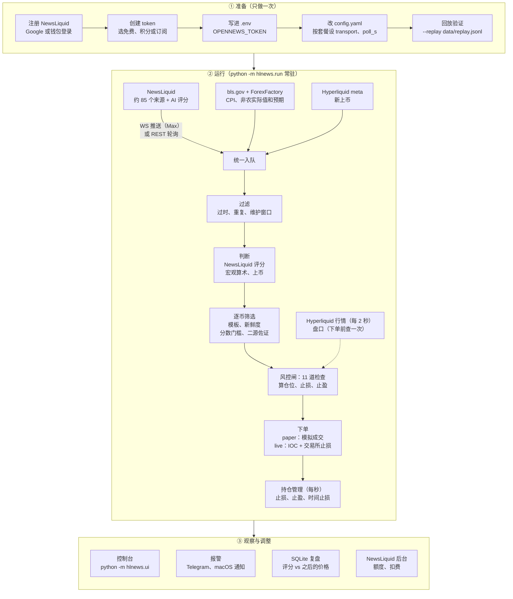

三个阶段：准备只做一次；运行就是 `python -m hlnews.run` 常驻；观察阶段看控制台、报警和数据库，必要时回到第 ① 步调门槛、订阅的来源或套餐。

### 0.2 信息从哪来

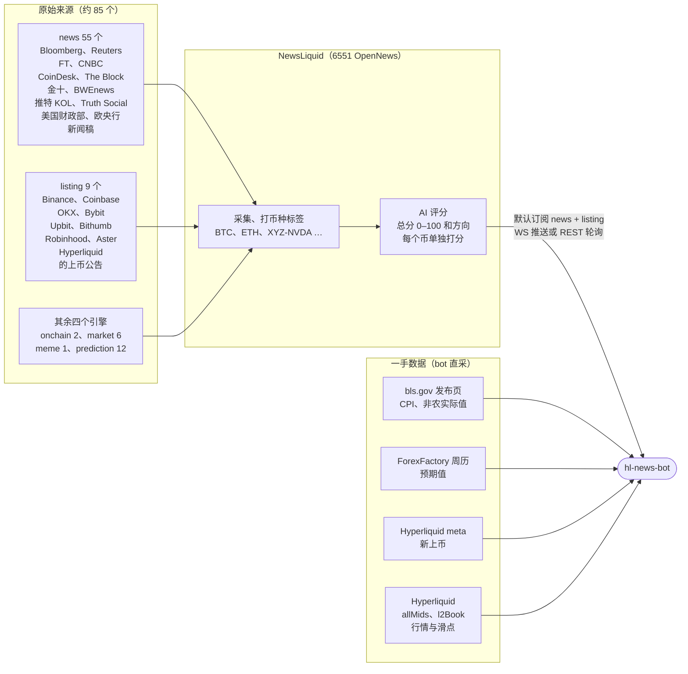

默认只订阅 NewsLiquid 的 news 和 listing 两个引擎；另外四个引擎要用的话，在 `feeds.newsliquid.engine_types` 里加上，并给对应的事件类配模板（第 11 节）。

### 0.3 注册与接入 NewsLiquid

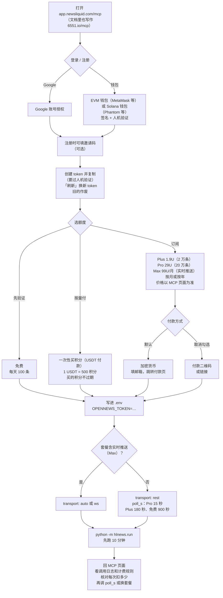

额度单位没有公开文档说清楚，第一次跑起来后一定要到 MCP 页面核对实际扣费，见第 15 节。

### 0.4 一条新闻怎么变成一笔交易

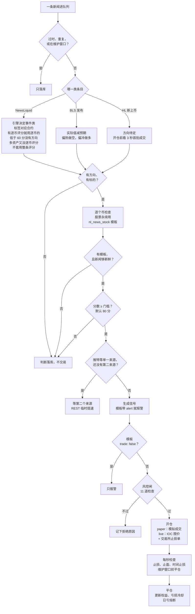

每一个"否"都会在数据库里留下记录：判断在 `classifications` 表，拒绝原因在 `decisions` 表。控制台的"新闻与决策"页按这张图把每条新闻的去向写出来。风控闸的 11 道检查见第 4.6 节。

### 0.5 模块架构

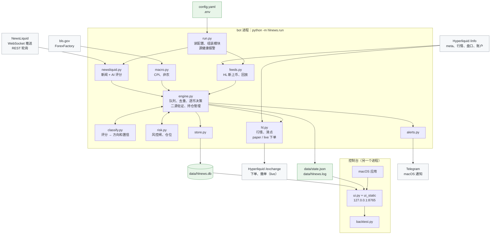

灰色是外部服务，绿色是本地文件，紫色是代码模块；`macro.py` 由 `engine.py` 启动，其余数据源由 `run.py` 组装。一个 bot 进程、一个 asyncio 事件循环。控制台是另一个进程：只读数据库、读 state.json 和日志，另外还能改 `config.yaml`、启停 bot（图里没画这两条回边，免得线绕回去）。并发细节见第 7 节，控制台见第 14 节。

---

## 1. 这套系统在赌什么

先把前提讲清楚，否则后面每个设计决定都像是随手拍的。

**新闻怎么来、谁来判断。** 2026-10-28 起，新闻的采集和判断都交给 NewsLiquid（6551 OpenNews）。它聚合约 85 个来源（Bloomberg、Reuters、金十、BWEnews、推特 KOL、Truth Social、九家交易所的上币公告等），每条新闻带一个 0–100 的 AI 影响分和方向（long / short / neutral），并对新闻涉及的每个币种单独打分。bot 不再读标题，只做三件事：把 NewsLiquid 标出的币种映射成 Hyperliquid 合约；按事件模板的门槛和来源策略决定开不开；执行和风控。之前自建的六个爬虫（Tree of Alpha、Telegram、Google News、华尔街见闻、金十、财联社）和规则 / LLM 双车道分类器已删除，取舍见第 15 节。

**这套系统抢不到"第一跳"。** CPI 这种定时数据，发布后 15 秒内价格已经走完 5 分钟行情的 85–90%；新闻经过 NewsLiquid 的采集和 AI 评分再到本机，又要几秒到几十秒（没有 Max 套餐时走 REST 轮询，默认每 15 秒一次）。它能做的是：

- **定时宏观数据的残余行情。** CPI 发布后 1 分钟已走完 30 分钟行情的 76%，但剩下的 24% 在 83% 的情况下和第一分钟方向一致。代码直接轮询 bls.gov 拿数字（1–3 秒），这条路不经过 NewsLiquid。
- **非计划冲击的延续。** Bybit 被盗、特朗普发帖、关税升级这类事件，价格的第一个极值通常在发帖后 2–5 分钟才出现，几秒到几十秒的延迟够用。但反转是常态（假 SEC 推文 15 分钟内走完来回），所以每笔都有硬性时间止损，推特这类单一来源的消息还要等第二个来源。
- **Hyperliquid 自己的新上币。** 通过 `meta` 接口 diff 发现，零延迟，和所有人同时知道。
- **美股财报后漂移。** 不赌前 10 秒（学术证据说那里没边际），赌 2 小时内的方向延续。

**明确不做的：** 币安 / Upbit 上币抢跑（付费同机房的人用毫秒级接入，你用秒级接入是去送钱）、任何毫秒级操作（Hyperliquid 自己在 BTC/ETH 价格发现上落后 Binance 约 800 毫秒）、财报前 10 秒。

**宁可漏不可错。** 默认门槛是 NewsLiquid 评分 80 分（`templates.nl_news.min_conf: 0.8`）。2026-10-28 的免费热榜（三个类别各取 24 小时内最热的 50 条，去重后 118 条）里，66 条带有本 universe 的币种，news 引擎里到 80 分的只有 1 条，而那 1 条是讲伊朗局势和原油的，同时标了六个资产却没有逐币评分，bot 不会把它当成 BTC 的做多信号（第 4.4 节）。推特、Telegram、微博等来源的单条消息即使分数够，也要等另一个来源同向确认。这不是 bug，是设计目标：先在 paper 里攒"评分 vs 之后的价格"，再决定门槛该不该放低。

**关于收益预期。** 第二部分 B8、B9 节有完整的数学。简单说：200% 年化需要 1.5 倍盈亏比下 ≥50% 的胜率加每年 250 次机会。NewsLiquid 评分作为方向判断有多准，目前没有独立验证（它公布的准确率是自报的），所以 paper 阶段的首要任务就是测这个。请把这套系统当成一个研究工具和执行框架，而不是印钞机。

---

## 2. 十分钟跑起来

### 环境

Python 3.10+（代码用了 `X | None` 类型语法和 `zoneinfo`）。在 Mac mini 上：

```bash
git clone https://github.com/yanboishere/hl-news-bot.git
cd hl-news-bot
python3 -m venv .venv && source .venv/bin/activate
pip install -r requirements.txt
```

`requirements.txt` 只有三个硬依赖：`hyperliquid-python-sdk`（官方 SDK）、`websockets`、`pyyaml`。跑测试另需 `pytest`。

### 第零步：NewsLiquid token

在 https://6551.io/mcp（或 app.newsliquid.com/mcp）注册拿 token，放进环境变量：

```bash
export OPENNEWS_TOKEN=...   # 或写进仓库根的 .env（已在 .gitignore 里，模板见 .env.example）
```

免费账号每天 100 条额度，只够验证接口；持续运行要买额度，第 15 节有按套餐的配置。回放和测试不需要 token。

### 第一步：回放

```bash
python -m hlnews.run --replay data/replay.jsonl --duration 15
```

`data/replay.jsonl` 的前 12 行是 2026-10-28 从 NewsLiquid 免费热榜接口取下的**真实条目和真实评分**（SK 海力士财报、英伟达投资 Meta、伊朗局势、比特币 ETF 流入等）；第 13 行是一条手写的**示例**，形状和实时推送一样、带逐币评分（BTC 看多 84、ETH 看空 55），文本里标着 `[EXAMPLE - not real news]`；最后两行是一条示例 BLS 数据（偏热的 CPI）和一条没有评分的普通标题。你会看到类似：

```
INFO hl: HL client ready mode=paper dexs=['', 'xyz'] coins=375
INFO alerts: ALERT [key_news] nl_news BTC long 84 | [EXAMPLE - not real news] Shape of a live news.ai_update ...
INFO engine: OPEN PAPER long BTC size=0.00828 @ 80506.6992 notional=$667 (0.33x equity, margin lev 2x) stop=79292.9925 tp=82513.0125 hold=3600s news_age=285190.4s slip=0.8bps
INFO engine: REJECT macro_cpi short BTC: per-coin cooldown BTC
INFO engine: OPEN PAPER short ETH size=0.53610 @ 2331.6000 notional=$1250 (0.62x equity, margin lev 3x) stop=2349.9000 tp=2303.2750 hold=1800s news_age=285131.8s slip=0.2bps
WARNING engine: flattening 2 open positions
INFO engine: CLOSE PAPER long BTC @ 80502.0000 reason=shutdown pnl=$-0.64 fees=$0.60 equity=$1999.36
INFO engine: CLOSE PAPER short ETH @ 2331.7000 reason=shutdown pnl=$-1.18 fees=$1.12 equity=$1998.18
```

12 条真实条目一条都没交易：82 分的伊朗条目同时标了原油、BTC、ETH 等六个资产且没有逐币评分，不套到 BTC 上；另一条 82 分来自 `meme` 引擎（推特），没有交易模板；78 分、72 分的停在 80 分门槛下面，但判断照样落库，控制台里能看到；同一个 Datavault 新闻的两个版本被去重。示例条目开了 BTC 多单（ETH 的 55 分低于最低分 60，不给方向）；CPI 偏热的做空在 BTC 上被同币冷却拒掉，在 ETH 上开了空单。每一行的含义第 8 节会逐字解释。注意价格是**实时的** Hyperliquid 价格，回放只是替换了新闻源。15 秒后进程自动退出并打印汇总 JSON。

### 第二步：paper 实盘

```bash
python -m hlnews.run
```

接三路真实源：NewsLiquid（有 Max 套餐时走 WebSocket 推送，否则 REST 每 15 秒轮询一次）、Hyperliquid 新上币探测、BLS 宏观数据定时轮询。没有设 `OPENNEWS_TOKEN` 时 NewsLiquid 源会报 `auth_fail` 并停下，另外两路照常。按 Ctrl-C 退出时会先平掉所有 paper 持仓。大部分时间它什么都不做，这是正常的。

### 第三步：看结果

```bash
python -m hlnews.ui            # 浏览器打开 http://127.0.0.1:8765，四个页面；第 14 节有说明
python -m hlnews.run --summary
sqlite3 data/hlnews.db "select reason, count(*) from decisions group by reason order by 2 desc"
```

### 第四步（可选）：事件回测

```bash
python -m hlnews.backtest --events data/events.jsonl --delay 20
python -m hlnews.backtest --events data/events.jsonl --sweep
```

用 Binance 1 分钟 K 线对 45 个历史事件跑模板，`--sweep` 扫描入场延迟 5/20/60/180/300 秒。事件文件里的 `event_class` 是历史标签（hack_exploit、etf、tariff 等来自旧的规则车道），没有对应模板时按今天的 NewsLiquid 模板模拟：加密币用 `nl_news`，股票永续用 `nl_news_stock`，结果仍按历史标签分组。它的用途是测模板参数对延迟的敏感性；方向是事后给定的，所以**不能**用它估计胜率。

### 测试

```bash
pip install pytest
python -m pytest -q tests
```

37 个测试，不连外网：Hyperliquid 用假客户端，NewsLiquid 用假 REST 和本地 WebSocket 服务器。覆盖三种条目形状的解析、REST 轮询、WS 推送、握手被拒时改走 REST、断线补漏、"静默 WS"检测、突发分页、评分到信号的映射、二源佐证、回测模板回退，以及上面那份回放的完整结果。

---

## 3. 一条新闻的完整生命周期

用回放里那条示例走一遍实时路径（Max 套餐，WebSocket 推送）。它的形状和 NewsLiquid 文档里的 `news.ai_update` 一样：整条 84 分看多，BTC 84 分看多，ETH 55 分看空。

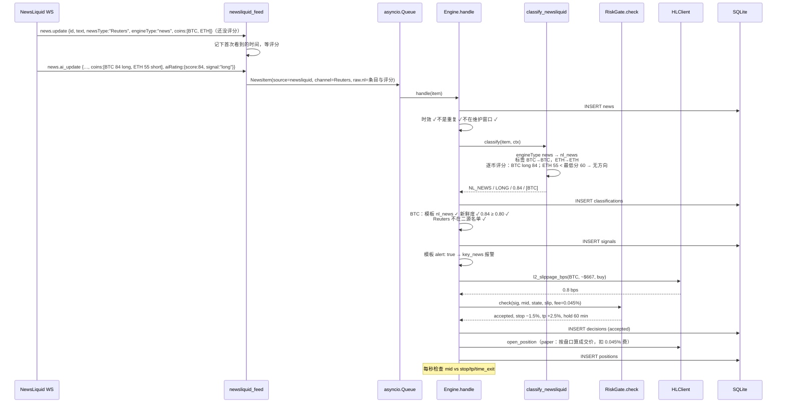

逐步说明：

1. **采集**（`newsliquid.py`）。WebSocket 订阅之后，NewsLiquid 先推 `news.update`（原文，还没评分），评分完成后再推 `news.ai_update`。只有带评分的才进管线。`news.update` 的到达时间记在 `raw.nl_first_seen_ms`，评分到达时间记在 `raw.nl_rated_ms`，差值就是 NewsLiquid 的 AI 评分延迟（第 8 节有查询）。没有 Max 套餐时同样的条目来自 REST 轮询（`POST /open/news_search`），还没评完分的先挂起，下一轮再看。

2. **入队**（`engine._pump`）。所有源共享一个 `asyncio.Queue`，上限 1 万条，满了就丢并报错。

3. **三道前置过滤**（`engine.handle` 开头）。先落库，然后：超过 `feeds.max_age_by_source.newsliquid`（30 分钟）的旧消息丢掉；12 词指纹在 10 分钟内见过的丢掉（同一事件常有 Bloomberg、Reuters、推特几个版本，NewsLiquid 给的 id 各不相同）；周五维护窗口内不开新仓。

4. **评分 → 判断**（`classify_newsliquid`）。不读正文。`engineType` 决定事件类（news → `nl_news`，listing → `nl_listing`……）；币种标签按精确规则映射成 HL 合约；有逐币评分时每个币用自己的方向和分数，82 分 → 0.82 这样直接换算。低于 `rating.min_score`（60）的不给方向，ETH 的 55 分就是这样。耗时 <1 毫秒。

5. **逐币决策**（`engine.handle` 里的循环）。股票永续的 news 条目换用 `nl_news_stock` 模板；然后依次检查：有没有模板、新闻是否超过模板的 `max_news_age_s`、分数是否过模板门槛 `min_conf`、来源是否在二源名单里。

6. **二源佐证**（`Corroboration`）。`rating.require_two_sources_for` 里的来源（twitter、telegram、weibo 等）单独一条不开仓，要等另一个来源在窗口内给出同一（事件类, 币, 方向）且同样过了门槛。这条来自 Reuters，不在名单里，直接放行。

7. **信号落库 + 报警 + 执行**（`_execute`）。模板带 `alert: true` 的先推一条 key_news 报警（同一事件 6 小时只推一次），然后检查价格新鲜度（15 秒内），拉一次盘口估算这笔名义的滑点，再把全部信息交给风控闸。

8. **风控闸**（`RiskGate.check`）。11 道检查按顺序执行，任何一道不过就返回拒绝原因并落库。都过了就算仓位：风险预算 = 权益 × 0.5% = $10；止损距离 1.5%；名义 = $10 / 1.5% = $667。然后被四个上限封顶（单笔名义 $4,000、模板杠杆 2x、币种最大杠杆、总杠杆 3x）。

9. **开仓**（`HLClient.open_position`）。paper 模式按盘口逐档吃单算成交价（这里 0.8 bps），扣 0.045% 吃单费。live 模式发 IOC 限价单（mid ± 0.3%），成交后立刻挂一张 reduce-only 的触发止损单在交易所。

10. **持仓管理**（`_manage_positions`）。每秒一次，用最新 mid 检查：碰到止损价 → `stop`；碰到止盈价 → `take_profit`；超过持有时间 → `time_stop`。任一触发就平仓、落库、更新权益、更新亏损冷却、检查日亏熔断。

---

## 4. 模块逐个讲

### 4.1 models.py：五个数据类型

整个系统在模块之间传递的只有这五个东西，理解它们就理解了数据流。

| 类型 | 谁产生 | 谁消费 | 关键字段 |
|---|---|---|---|
| `NewsItem` | newsliquid / feeds / macro | engine | `source`（newsliquid / hl_listings / bls_poll / replay）、`channel`（NewsLiquid 的 newsType，如 Bloomberg、Twitter、jin10；或 meta_diff、usGov）、`title`、`ts_ms`（源时间戳）、`recv_ms`（本机接收时间）、`suggestions`（NewsLiquid 标的币种）、`raw`（NewsLiquid 条目在 `raw.nl` 里：原文、引擎、币种标签、评分） |
| `Classification` | classify | engine | `lane`（newsliquid / macro / hl_listing / none）、`event_class`、`direction`、`confidence`、`tickers`（HL 币名列表）、`per_ticker`（逐币方向和分数）、`is_scheduled`、`latency_ms` |
| `Signal` | engine | risk / store | 一个（新闻, 币, 方向）组合 + 这一类的 `template` 字典 + `news_age_s` |
| `Position` | engine → hl | hl / store | 开仓时的 size/entry/stop/tp/time_exit/notional/leverage，平仓时补 exit_px/exit_ms/exit_reason/pnl_usd |
| `EventClass` / `Direction` | 枚举 | 全部 | 11 个事件类：一手数据 3 个（macro_cpi、macro_nfp、listing_hl）、NewsLiquid 7 个（nl_news、nl_news_stock、nl_listing、nl_onchain、nl_market、nl_meme、nl_prediction）、noise；3 个方向（LONG/SHORT/NONE） |

两个小细节：`NewsItem.age_s` 是属性，等于 `(recv_ms − ts_ms)/1000`，负数会被钳到 0；`Position.to_row()` 把枚举转成字符串以便写 SQLite。

### 4.2 newsliquid.py 与 feeds.py：新闻从哪来

每个源都是一个 `async generator`，`yield NewsItem`。新闻只有一个源：`newsliquid_feed`。

**`newsliquid_feed`**（`hlnews/newsliquid.py`）有三种传输，`feeds.newsliquid.transport` 选：

| 传输 | 怎么连 | 适合 |
|---|---|---|
| `ws` | `wss://ai.6551.io/open/news_wss?token=…`，JSON-RPC 2.0：发 `news.subscribe`（带 `engineTypes` / `coins` / `hasCoin` 过滤），收 `news.update` 和 `news.ai_update`；每 20 秒发文本 `ping`，服务端回 `pong`，60 秒没有任何帧就重连 | Max 套餐（实时推送） |
| `rest` | `POST https://ai.6551.io/open/news_search`，`Authorization: Bearer`，每 `poll_s` 秒一次，每次调用扣额度 | 其他付费套餐 |
| `auto`（默认） | 先连 WS；握手被拒（401/402/403）或订阅返回错误就改走 REST，`ws_retry_s`（30 分钟）后再试 WS；WS 断开期间 REST 自动接管 | 不确定套餐时 |

几个实现细节：

- **字段归一**（`normalize`）。同一条新闻有三种形状：WS 推送（`aiRating` 嵌套、`ts` 是毫秒）、REST 行（`aiRating.status` 可能还没到 done，`ts` 可能是 ISO 字符串）、免费热榜（`score/grade/signal` 平铺，`published_at` 带 +08:00）。全部归一成 `{id, text, news_type, engine_type, link, ts_ms, coins[], rating}`；`rating` 为空表示 AI 还没评完，这类条目挂起不交易。
- **只交易开机之后的新闻。** REST 返回的行里，发布时间早于本进程启动的一律当历史，只记"已见"不交易，所以重启不会把上一页旧闻再交易一遍。WS 推送本来就是新的，不做这个过滤。
- **断线补漏。** WS 每次（重新）订阅成功，用一次 REST 补上断线期间发布、但没推过来的条目。
- **静默 WS 检测。** WS 在线时，每 `ws_audit_s`（5 分钟）用一次 REST 抽查：如果 REST 里有已评分、发布超过 2 分钟、WS 却从没推过的条目，说明推送在漏，报 `ws_gap` 并把漏掉的补进来；如果这次连接 WS 一条都没推过，REST 接管轮询。这防的是"套餐不含实时推送，但服务端照样接受订阅、然后什么也不推"。
- **突发分页。** 一页 50 条全是开机后的新条目时，继续读第 2、3 页（每页一次调用）。
- **错误分类。** HTTP 401/402/403 → token 无效或套餐不含该接口（`auth_fail`，5 分钟后重试）；429 或额度类错误 → `quota`（REST 暂停 10 分钟）；其他错误连续 3 次 → `rest_fail`。这些状态通过 `on_health` 回调变成 `feed` 类报警，出问题和恢复时各推一次。2026-10-28 用无效 token 对真实服务器实测：WS 握手 HTTP 401 `unauthorized`，REST 401 `{"error":"invalid token"}`，两条路径都按上面处理。
- **HTML 清理。** 金十的汇总条目带 `<b>`、`<br/>`、`&#8217;`，标题里清掉，原文留在 `raw.nl.text`。

**`hl_listings_feed`**（`feeds.py`）— 轮询 POST `{"type":"meta"}`（和 `{"type":"meta","dex":"xyz"}`），每个 dex 之后 sleep 1.5 秒、一轮之后 sleep `poll_s`（默认 5），两个 dex 的实际周期约 8 秒，把 `universe` 里非 `isDelisted` 的名字做成集合，和上一轮比较，新出现的名字生成一条 `source="hl_listings"` 的 NewsItem。第一轮只建基线不触发。sleep 是为了不撞 IP 限速。

**`replay_feed`**（`feeds.py`）— 读 JSONL。每行可以是 NewsLiquid 条目（三种形状都行，和实时条目一样分类）、BLS 宏观记录（`kind` / `parsed` / `consensus`），或者没有评分的普通标题（只落库，永远没有方向）。`speed=0` 尽快灌入，`speed=1` 按原始时间间隔重放。`source="replay"`，引擎对这个 source 跳过时效过滤。

### 4.3 macro.py：定时宏观数据的直采

为什么单独写一个模块：CPI 的行情 15 秒走完大半，等新闻源转发要 5–20 秒（经过 NewsLiquid 的评分和轮询还要更久），直接轮询 bls.gov 只要 1–3 秒。这是保留下来的一手数据通道，不经过 NewsLiquid。

`MacroScheduler.run` 的状态机：

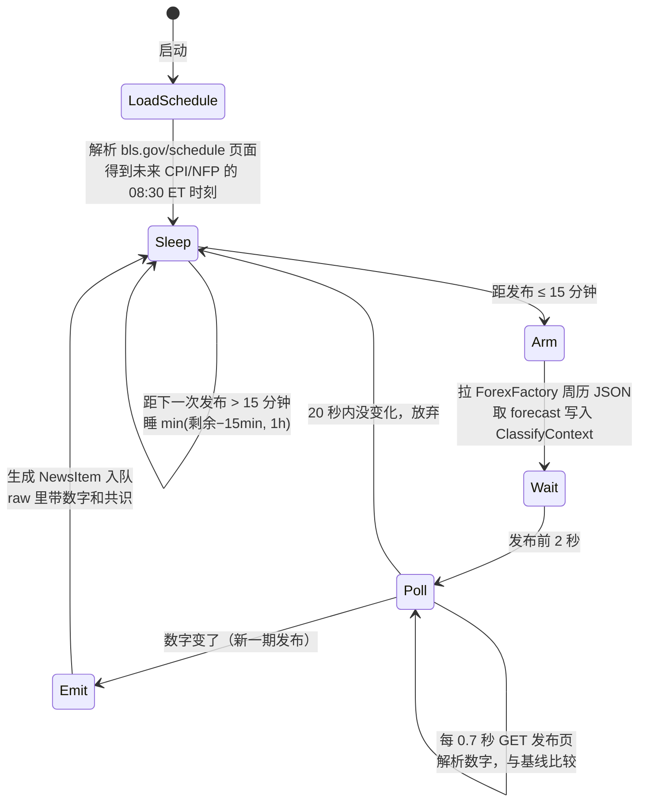

几个实现细节：

- **日程解析**（`parse_bls_schedule`）：从 HTML 里正则出 "Oct. 14, 2026" 格式的日期，用 `zoneinfo` 的 America/New_York 转成 UTC（自动处理夏令时：夏令时 12:30 UTC，冬令时 13:30 UTC）。
- **共识**（`ff_consensus`）：ForexFactory 的 `ff_calendar_thisweek.json` 只有 `forecast`/`previous`，没有 `actual`。匹配标题 "CPI y/y"、"Core CPI y/y"、"Non-Farm Employment Change"。注意这个 JSON 只覆盖**本周**，所以 T−15 分钟去拉是合理的。
- **变化检测**（`_poll_release`）：发布页在发布前就存在，内容是上个月的数字。第一次 GET 的解析结果作为基线，之后任何一次解析结果不同就判定为新发布。
- **解析器**（`parse_cpi`/`parse_nfp`）：从去标签后的正文里正则 "Over the last 12 months, the all items index increased 3.4 percent"（总体同比）、"all items less food and energy index rose 2.4 percent over the year"（核心同比）、"nonfarm payroll employment rose by 162,000"（NFP，自动把 162,000 换算成 162k 以和 FF 共识同单位）。已对 2026-09 的真实页面验证。这是解析政府网页的固定格式，不是判断新闻。
- **请求头**：`UA` 常量里有联系方式占位符。BLS 会封匿名高频客户端，上线前把 `set-your-email@example.com` 改成真实邮箱。
- **判断是算术。** 发布条目的 `raw` 带着 `kind`、`parsed`（实际值）和 `consensus`（预期），`classify_macro` 直接做减法判方向，不解析标题。标题 `BLS: CPI YoY ACTUAL 3.4% (FORECAST 3.1%); …` 只用于显示。

**FOMC 没有直采**：日程里只加载了 cpi 和 empsit 两个页面。美联储决议作为 NewsLiquid 的新闻进来（金十、Reuters 等），走 `nl_news` 模板。

### 4.4 classify.py：评分到判断

**为什么不再自己判断。** 旧版用一串正则规则（<1 毫秒，但只覆盖措辞确定的事，对中文快讯基本判噪音）加一条可选的 LLM 车道。现在判断交给 NewsLiquid：它给每条新闻和每个相关币种打分，覆盖中英文和 85 个来源。这里剩下的代码不读正文，只做映射和算术，三条车道：

| 车道 | 输入 | 输出 |
|---|---|---|
| `newsliquid` | `raw.nl` 里的评分 | 事件类 = 引擎（news → `nl_news`，listing → `nl_listing`……）；方向 = signal；置信 = score / 100；标的 = 映射成功的币种；逐币方向和分数存进 `per_ticker` |
| `macro` | BLS 发布条目的数字和共识 | CPI：总体差 + 核心差的绝对值 ≥0.1，偏热做空、偏冷做多，置信 0.85；非农：差 ≥50k，强于预期做空、弱于预期做多，置信 0.80；否则无方向 |
| `hl_listing` | HL meta diff | LISTING_HL / LONG（占位）/ 0.90，引擎看首批成交改方向 |

不是 NewsLiquid 条目、也不是一手数据的（比如回放里的普通标题）一律 `noise`。

**币种映射**（`map_symbol`）只做精确匹配，不猜：

- `BTC`、`ETH` 这类加密币标签：在 universe 里就用。
- `XYZ-NVDA`：NewsLiquid 给 trade.xyz 股票永续的标签，映射成 `xyz:NVDA`。
- 纯股票代码 `NVDA`：忽略。NewsLiquid 指 Hyperliquid 股票永续时总会加 `XYZ-` 标签（2026-10-28 热榜样本里，universe 内 11 只股票的标签出现了 123 次，其中带纯代码的 60 次全部同时带 `XYZ-`），而纯代码可能和同名加密代币撞。
- `xyz:SKHX` 和 `xyz:SKHY` 是 Hyperliquid 上两个不同的合约，标签之间从不互相别名。
- 名字对不上的（比如 `PEPE` → `kPEPE`）写进 `universe.symbol_map`。

**逐币评分。** NewsLiquid 文档写明顶层 `aiRating.score` 是所有币里的最高分，同一条新闻可能 BTC 84 分看多、ETH 55 分看空。`rating.use_coin_rating: true`（默认）时每个币用自己的方向和分数，所以一条新闻可能开出一多一空两条腿。

**没有逐币评分时怎么办**（`rating.item_rating_fallback`）。免费热榜的条目只有一个整条评分。整条评分是"所有币里的最高分"，当一条新闻同时标了原油、BTC、ETH 时，这个 long 很可能说的是原油。默认 `single`：只有当条目只涉及一个资产（`XYZ-NVDA` 和 `NVDA` 算同一个）时，才把整条评分套到这个币上；涉及多个资产时，没有自己评分的币不给方向，理由里写 `item rating not applied: N assets tagged`。回放里那条 82 分的伊朗条目（标签 CL、XYZ-CL、BTC、ETH、EPIC、SOL）就是这样被挡下的。`all` 恢复成全部套用，`none` 只认逐币评分。

**最低分。** 低于 `rating.min_score`（60）的评分不给方向，`neutral` 也不给方向；它们照样落库，用来以后调门槛。

### 4.5 engine.py：主循环、去重、门槛、二源佐证、持仓管理

**`Dedup`**。指纹算法：小写 → 去 URL → 去 "Name (@handle): " 前缀 → 只保留字母数字和 `%$.` → 取前 12 个词 → SHA1 前 16 位；中文标题用前 24 个汉字加文中数字。10 分钟滑动窗口，最多记 5,000 条。同一事件的 Bloomberg、Reuters、推特版本通常前 12 个词不同，所以这个去重是"宽松"的，主要防完全相同的转发。

**逐币决策**（`handle` 里的循环）：

```
for 币 in 分类给出的标的:
    方向、分数 = per_ticker[币]（没有就用整条的）
    事件类     = nl_news_stock if (nl_news 且币是 xyz:) else 原事件类
    没有模板                        → 跳过（nl_market / nl_onchain / nl_meme / nl_prediction 默认没有）
    新闻年龄 > 模板 max_news_age_s   → 跳过
    分数 < 模板 min_conf             → 跳过（判断已落库）
    来源在二源名单且来源数 < 2        → 拉起热窗口，打印 waiting for a second source，跳过
    生成信号
```

**`Corroboration`**。键是 `(事件类, 币, 方向)`，值是窗口内的 `(时间, 来源键)` 列表，来源键 = `f"{source}:{newsType 小写}"`，所以两条推特永远只算一个来源。窗口默认 90 秒，`nl_news_stock` 30 分钟（股票新闻转述得慢）。只有过了门槛的条目才计入：第二个来源也得被 NewsLiquid 打到门槛以上。注意它是"跳过"而不是"挂起等待"：第二条来源到达时会自己走一遍完整流程，那时计数到 2 就放行了。所以同一事件最终由**第二条**新闻触发交易，`news_age_s` 记录的也是第二条的延迟。

**热窗口**只在"等第二来源"时拉起（最长 120 秒），让 REST 轮询从 15 秒降到 5 秒，第二条来得更快。旧版在任何有方向的标题之后都拉起；按 NewsLiquid 的条目量，那样会把 REST 额度用超（第 15 节）。

**报警**。同一条新闻里模板带 `alert: true` 的信号合成一条 key_news 报警，同一（事件类, 币组合, 方向）6 小时内只推一次。

**`_execute`**：

1. 价格陈旧检查：`mids_ms` 距今 >15 秒拒绝（防止行情断了还在按旧价下单）。
2. `LISTING_HL` 特殊处理：睡 3 秒，刷新价格，比较前后 mid 决定方向（顺着首批成交的方向）。
3. 预估名义 = 权益 × risk_pct / stop_pct，拉盘口估滑点。
4. 风控闸。
5. 开仓。连续失败 3 次 → 熔断（`halted_reason`）。成功则清零计数。
6. 落库、打 OPEN 日志。

**`_manage_positions`**：每秒一轮。先看是否进入维护窗口前 5 分钟，是则全平（`pre_maintenance`）。然后对每个持仓按 mid 判断 stop / take_profit / time_stop。判断顺序是止损优先于止盈。

**`_close`**：平仓 → 从 open 列表移除 → 落库 → paper 模式把 pnl 加到权益 → 亏损则记 `last_loss_ms`（触发 15 分钟冷却）→ 检查日亏是否 ≥3%，是则熔断。

**`_equity_loop`**：每 60 秒。live 模式从链上读权益；所有模式检查 UTC 日/周翻转（翻日时重置 `day_start_equity`，并解除以 "daily" 开头的熔断）；写一行 `equity` 表。

**`in_maintenance_window`**：UTC 周几 + "HH:MM" 字符串比较。默认周五 07:55–09:35。`_manage_positions` 传 `time.time()+300` 来实现"提前 5 分钟"。

### 4.6 risk.py：风控闸与仓位计算

`RiskGate.check` 是纯函数：输入信号、mid、账户状态、滑点估计、费率，输出 `Decision`。拒绝原因全部落 `decisions` 表，这是日后调参的主要数据来源。

11 道检查，按顺序：

| # | 检查 | 拒绝原因文本 | 配置项 |
|---|---|---|---|
| 1 | 是否熔断 | `halted: daily loss 3.2%` / `halted: 3 consecutive order failures` | — |
| 2 | 有方向 | `no direction` | — |
| 3 | 置信 ≥ 模板门槛 | `confidence 0.78 < 0.8`（NewsLiquid 条目在引擎里已按门槛过滤，这里主要兜底宏观和上币） | `templates.*.min_conf` |
| 4 | 日亏 < 上限 | `daily loss limit hit (3.1%)` | `account.daily_loss_limit_pct` |
| 5 | 周亏 < 上限 | `weekly loss limit hit (6.2%)` | `account.weekly_loss_limit_pct` |
| 6 | 亏损后冷却 | `cooldown after loss` | `account.cooldown_after_loss_s` (900) |
| 7 | 同币冷却 | `per-coin cooldown ETH` | `account.per_coin_cooldown_s` (600) |
| 8 | 持仓数 | `max open positions` | `account.max_open_positions` (2) |
| 9 | 不重复开同一币 | `already in ETH` | — |
| 10 | 成本/止损比 | `cost 0.13% too large vs stop 0.30%` | 硬编码 35% |
| 11 | 名义 ≥ $12 | `notional 8 below minimum` | 交易所最小单 $10 |

第 10 道的公式：`rt_cost_pct = 2×taker_fee×100 + 2×slippage_bps/100`。BTC/ETH 吃单 0.045%，往返 0.09%，加 2 bps 滑点×2 = 0.13%。止损 0.8% 时占 16%，过；止损 0.3% 时占 43%，拒。这就是为什么所有模板的止损都 ≥0.8%。

**仓位计算**（第 11 道之前）：

```
risk_pct  = min(模板 risk_pct, account.max_risk_per_trade_pct)
risk_usd  = equity × risk_pct / 100
notional  = risk_usd / (stop_pct / 100)              ← 核心公式：止损处亏 risk_usd
notional  = min(notional, max_notional_per_trade_usd) ← 封顶 1
lev_cap   = min(模板 max_lev, 币种 maxLeverage)
notional  = min(notional, equity × lev_cap)           ← 封顶 2
room      = equity × max_gross_leverage − 已有持仓名义之和
notional  = min(notional, room)                       ← 封顶 3
size      = notional / mid
stop_px   = mid × (1 ∓ stop_pct/100)
tp_px     = mid × (1 ± tp_pct/100)
```

`Decision.leverage` 返回的是 `lev_cap`（交易所侧要设的保证金杠杆），`Decision.equity_ratio` 是 `notional/equity`（这笔占了多少倍权益）。两者分开是因为：live 模式下交易所的杠杆设置决定占用多少保证金，设成模板上限意味着几百美元名义只占三分之一到二分之一的保证金，两个持仓可以并存；如果设成实际的 0.33x 会报错或占满保证金。日志里 `(0.33x equity, margin lev 2x)` 就是这两个数。

### 4.7 hl.py：行情、滑点估计、paper 与 live 执行

`HLClient` 一个类两种模式，`open_position`/`close_position` 内部按 `self.mode` 分支，其余代码路径完全共享。

**启动**（`start`）：用 SDK 的 `Info(perp_dexs=["", "xyz"])` 建索引（**必须显式传 `perp_dexs`**，否则 `xyz:TSLA` 解析不了，SDK issue #281）；对每个 dex POST `meta` 读出每个币的 `szDecimals`（数量精度）、`maxLeverage`、`growthMode`（HIP-3 低费率模式）、`onlyIsolated`/`marginMode`（是否只能逐仓）；拉一次 `allMids`；live 模式再从环境变量 `HL_AGENT_KEY`/`HL_ACCOUNT` 建 `Exchange`。

**行情**（`refresh_mids`/`mids_loop`）：REST 轮询 `allMids`，每 2 秒一轮，两个 dex 之间 sleep 0.6 秒。为什么不用 WebSocket：官方 SDK 的 WS 管理器没有重连逻辑，REST 轮询 2 秒对这个策略的时间尺度（持仓 30 分钟到 2 小时）够用，且简单可靠。`mids_ms` 记录最后成功时间，引擎用它判断陈旧。

**滑点估计**（`l2_slippage_bps`）：POST `l2Book` 拿 20 档，按方向逐档吃到 `notional_usd` 为止，算加权均价相对 mid 的偏离。深度不够返回 25 bps（会被成本检查拒掉），请求失败返回 2 bps 保底。paper 模式开仓和平仓都用它算成交价。

**费率**（`taker_fee`）：BTC/ETH 0.045%；HIP-3 标的 `growthMode` 开启 0.009%，否则 0.09%。都是基础档吃单费，没算推荐码折扣。

**paper 开仓**：成交价 = mid ± 滑点，手续费 = 名义 × 费率，不发任何请求到交易所。

**live 开仓**，在一个 `asyncio.Lock` 内顺序执行：

1. `update_leverage(lev, coin, is_cross)`：lev 取 `min(模板上限, 币种上限)`；BTC/ETH 全仓，HIP-3 逐仓（`onlyIsolated` 的强制逐仓，其他 HIP-3 也逐仓）。
2. `order(coin, is_buy, size, limit_px, {"limit":{"tif":"Ioc"}})`：限价 = mid × (1 ± 0.3%)，IOC 意味着能成交多少成交多少、剩下的取消，不会挂在簿上。价格按 `_round_px` 规整到 5 位有效数字且小数位 ≤ 6−szDecimals（BTC 在 8 万价位上就是整数）；数量按 `_round_sz` 向下截断到 szDecimals。
3. 读 `statuses[0]`，没有 `filled` 就抛异常（引擎记一次失败）。
4. 再下一张 `{"trigger":{"triggerPx":stop,"isMarket":true,"tpsl":"sl"}}` 的 reduce-only 触发单作为交易所侧止损。

**live 平仓**：先用 `frontend_open_orders` 找出该币所有挂单（即那张止损单）逐个取消，再 `market_close`（SDK 内部也是 reduce-only IOC）。

**权益**（`equity_usd`）：标准账户模式对每个 dex 读 `clearinghouseState` 累加；统一账户模式（`unified_account: true`）只读主状态。

**`_round_px` 的两条规则**来自官方文档："价格最多 5 位有效数字，且小数位不超过 6 − szDecimals"。SDK 的 `float_to_wire` 遇到舍入误差直接抛异常，所以必须自己先 round。

### 4.8 store.py：SQLite 里有什么

七张表，WAL 模式，线程锁保护。表结构这次没变，旧数据库可以直接用。

| 表 | 一行是什么 | 关键列 |
|---|---|---|
| `news` | 每一条进入引擎的新闻（去重前） | id, source, channel, account, title, ts_ms, recv_ms, age_s, raw(JSON，NewsLiquid 条目在 `raw.nl`，评分延迟在 `raw.nl_first_seen_ms` / `raw.nl_rated_ms`) |
| `classifications` | 每一次分类结果，一条新闻一行 | news_id, lane（newsliquid / macro / hl_listing / none）, event_class, direction, confidence, tickers, reason（逐币方向和分数写在这里）, latency_ms |
| `signals` | 过了门槛和佐证、进入风控的 | id, news_id, coin, direction, event_class, confidence, template(JSON), news_age_s |
| `decisions` | 风控结果，接受或拒绝都有 | signal_id, accepted, reason |
| `positions` | 持仓，开仓时插入，平仓时 REPLACE | 全部 Position 字段 |
| `equity` | 每分钟一行 | ts_ms, equity_usd, open_positions |
| `alerts` | 每一次报警（key_news / open / close / halt / feed） | ts_ms, kind, title, body, meta |

`Store.summary()` 返回新闻数、信号数、已平仓数、胜数、总盈亏、按事件类分组的统计。

### 4.9 backtest.py：事件回测器

输入 `data/events.jsonl`，每行 `{ts_utc, coin, direction, event_class, note}`。对每个事件：

1. 找模板：先按 `event_class` 找；找不到（旧的规则车道标签，如 hack_exploit、etf）就用今天会用的 NewsLiquid 模板，加密币 `nl_news`、`xyz:` 股票 `nl_news_stock`。
2. 从 Binance 拉 1 分钟 K（`BTC`→`BTCUSDT`，`ETH`→`ETHUSDT`；HIP-3 标的没有免费分钟级历史，除非事件里给 `symbol` 字段，否则跳过）。
3. 在 `ts_utc + delay` 处按分钟内线性插值得到入场价。
4. 逐根 K 线检查：先止损（用 low/high 触碰）、再止盈、再时间止损（用 close）。
5. 收益扣 0.09% 往返费 + 0.04% 往返滑点。

输出按事件类（历史标签）的 n、胜率、均值、中位、总 R 倍数、各退出原因计数，以及 `breakeven_win_rate_if_tp_or_stop = stop/(stop+tp)`（如果每笔要么止盈要么止损，这个胜率是盈亏平衡点）。

`--sweep` 对延迟 5/20/60/180/300 秒各跑一遍。CPI 的结果是 5 秒 66% 胜率、20 秒 53%、60 秒归零、180 秒为负，这直接决定了"CPI 只在 BLS 直采路径下交易"这个设计决定。

### 4.10 run.py：入口与命令行

```
python -m hlnews.run [--config config.yaml] [--replay FILE] [--speed 0] [--duration 0] [--paper] [--summary]
```

| 参数 | 作用 |
|---|---|
| `--config` | 配置文件路径，默认 `config.yaml` |
| `--replay FILE` | 用 JSONL 替代 NewsLiquid 和上币探测。**拒绝在 live 模式下回放** |
| `--speed` | 回放速度，0 = 尽快，1 = 实时 |
| `--duration` | 跑多少秒后退出，0 = 直到 Ctrl-C。回放时默认 20 秒 |
| `--paper` | 无视配置强制 paper |
| `--summary` | 只打印数据库汇总，不启动引擎 |

启动顺序：读配置 → 建日志（同时写 stdout 和 `data/hlnews.log`）→ 建 Store → 建 HLClient 并 `start()` → 组装上币探测 → 建 Engine → 挂上 NewsLiquid 源（带健康回调，出问题和恢复时各推一次 `feed` 报警）→ 注册 SIGINT/SIGTERM → 跑。退出时：取消主任务 → `engine.shutdown()` 平掉所有持仓 → 等 0.3 秒让连接关干净 → 打印汇总。

---

## 5. config.yaml 逐项解释

```yaml
mode: paper                     # paper | live。live 还需要环境变量 HL_AGENT_KEY / HL_ACCOUNT

hyperliquid:
  network: mainnet              # mainnet | testnet。paper 模式也读 mainnet 价格
  unified_account: false        # 账户是否为统一账户模式（影响 live 下权益怎么读）
  perp_dexs: ["", "xyz"]        # "" = 验证者永续（BTC/ETH），"xyz" = trade.xyz 股票永续
  market_slippage: 0.003        # live IOC 限价相对 mid 的偏移。SDK 默认 5%，10-10 那天会成交在深渊
  poll_prices_s: 2.0            # allMids REST 轮询间隔（不用 SDK 的 WebSocket）

account:
  equity_usd: 2000              # paper 起始权益；live 模式每分钟被链上值覆盖
  max_risk_per_trade_pct: 1.0   # 单笔止损处最大亏损占权益比，模板 risk_pct 会被它封顶
  max_notional_per_trade_usd: 4000
  max_open_positions: 2
  max_gross_leverage: 3.0       # 所有持仓名义之和 ≤ 权益 × 3
  daily_loss_limit_pct: 3.0     # 日亏达到即熔断到 UTC 零点
  weekly_loss_limit_pct: 6.0
  cooldown_after_loss_s: 900    # 任何一笔亏损后 15 分钟不开新仓
  per_coin_cooldown_s: 600      # 同一币种 10 分钟内不再开

universe:
  crypto: ["BTC", "ETH"]
  stocks: ["xyz:TSLA", "xyz:NVDA", ...]   # HL 合约名；NewsLiquid 的 XYZ-NVDA 标签自动映射到 xyz:NVDA
  symbol_map: {}                # 标签和 HL 名字对不上时手工指定，如 {PEPE: kPEPE}

feeds:
  max_age_s: 120                # 没单独写的源，入口时效
  max_age_by_source: {newsliquid: 1800, hl_listings: 60, bls_poll: 60}
  newsliquid:
    enabled: true
    token_env: OPENNEWS_TOKEN   # 从这个环境变量读 token；token 本身不要写进配置
    transport: auto             # auto | ws | rest
    engine_types: {news: [], listing: []}   # 订阅哪些引擎；[] = 该引擎全部来源，也可以写来源代码
    coins: []                   # 只订某些标签，如 ["BTC", "XYZ-NVDA"]；空 = 全部
    has_coin: true              # 只要标了币种的条目
    poll_s: 15                  # REST 间隔；每次调用扣额度
    fast_poll_s: 5              # 热窗口里的 REST 间隔
    page_size: 50
    max_pages: 3                # 突发时最多读几页
    ws_retry_s: 1800            # WS 被拒后多久再试
    ws_audit_s: 300             # WS 在线时多久用 REST 抽查一次（0 = 不查）
    backfill_on_reconnect: true
  hl_listings: {enabled: true, poll_s: 5}
  macro: {enabled: true}        # BLS 日程 + FF 共识 + 发布秒级轮询

rating:
  min_score: 60                 # 低于此分只落库、不给方向
  use_coin_rating: true         # 有逐币评分时用逐币的
  item_rating_fallback: single  # 没有逐币评分时：single 只对单资产条目套用整条评分 | all | none
  require_two_sources_for: [twitter, twitter/x, x / twitter profile, telegram, weibo, medium]
  corroboration_window_s: 90
  corroboration_window_by_class: {nl_news_stock: 1800}

templates:                      # 见第 6 节
  nl_news: {hold_s: 3600, stop_pct: 1.5, tp_pct: 2.5, risk_pct: 0.5, max_lev: 2, min_conf: 0.8, alert: true, max_news_age_s: 300}
  ...

storage:
  sqlite_path: data/hlnews.db
  log_path: data/hlnews.log

alerts:                         # 报警：key_news / open / close / halt / feed；Telegram 需要 TELEGRAM_BOT_TOKEN / TELEGRAM_CHAT_ID
  on: [key_news, open, close, halt, feed]
  dedup_s: 21600

maintenance_window:             # Hyperliquid 每周升级的只挂单窗口
  enabled: true
  weekday_utc: 4                # 周五
  start_utc: "07:55"            # 实际窗口 08:00–09:30，前后各留 5 分钟
  end_utc: "09:35"
```

三个容易混淆的点：

- `feeds.max_age_by_source.newsliquid`（30 分钟）是入口的粗过滤，真正决定能不能交易的是各模板的 `max_news_age_s`（`nl_news` 5 分钟、`nl_news_stock` 30 分钟、`nl_listing` 2 分钟）。
- NewsLiquid 模板的 `min_conf` 就是评分 / 100（0.8 = 80 分）；`rating.min_score` 是更低的一道线，决定"有没有方向"，低于它的只落库。
- `templates.*.max_lev` 是**两个意思**：风控里它封顶名义（名义 ≤ 权益 × max_lev），live 执行里它是设给交易所的保证金杠杆。

---

## 6. 事件模板：每一类为什么是这些数字

| 事件类 | hold | stop | tp | risk | max_lev | min_conf | 为什么 |
|---|---|---|---|---|---|---|---|
| `macro_cpi` | 30 min | 0.8% | 1.2% | 0.5% | 3x | 0.80 | CPI 是一次性重定价，1 分钟走完 76%，4 小时后波动回到基线的 1.5–2 倍。持仓窗口短。止损 0.8% 是让往返成本（0.13%）占比 <20% 的最小值 |
| `macro_nfp` | 60 min | 0.9% | 1.2% | 0.4% | 2x | 0.80 | 第一分钟只走完 36%，但 23% 概率 30 分钟内翻转。风险更小、杠杆更低 |
| `listing_hl` | 10 min | 3.0% | 4.0% | 0.3% | 2x | 0.90 | 没有公开研究，纯动量假设。持仓最短、风险最小、止损最宽（新币波动大） |
| `nl_news` | 60 min | 1.5% | 2.5% | 0.5% | 2x | 0.80（80 分） | 沿用旧版黑客 / 关税 / 特朗普类的形状：Bybit 被盗发帖后 30 分钟 −4%，关税暂停 60 分钟 +5.2%，储备帖 60 分钟 +4.3%，这类冲击的第一个极值在 2–5 分钟后，1 小时内多半走完。风险预算取 0.5%，因为评分的准确率还没验证。新鲜度 5 分钟 |
| `nl_news_stock` | 120 min | 2.0% | 3.0% | 0.5% | 2x | 0.80 | 沿用旧版财报 / 指引：财报夜 70% 价格发现在前 5 分钟，之后赌 2 小时漂移。新鲜度放宽到 30 分钟，股票新闻在加密圈扩散得慢（东芝 HDD 那次 WDC 永续 13 小时后才动） |
| `nl_listing` | 10 min | 3.0% | 4.0% | 0.3% | 2x | 0.85 | 交易所上币。BTC/ETH 和股票永续都谈不上"上币"，对当前 universe 几乎不会触发；`trade: false` 只报警。扩大 universe（比如加 SOL、HYPE）后再决定开不开 |
| `nl_market` / `nl_onchain` / `nl_meme` / `nl_prediction` | — | — | — | — | — | — | 无模板，即使在 `engine_types` 里订阅了也只落库。行情异动是价格本身的派生，链上只覆盖 Hyperliquid 大户，meme 和预测类没有验证 |

旧版的 `macro_fomc`、`hack_exploit`、`depeg`、`etf`、`regulatory`、`tariff`、`trump_policy`、`earnings`、`guidance`、`supply_*` 模板已删除。它们对应的是规则车道识别出的事件类型，而 NewsLiquid 不输出事件类型，这些新闻现在都落在 `nl_news` / `nl_news_stock` 里。代价是不能再按事件类型给不同的持仓时间，见第 12 节。

**改模板的方法论**：跑 `backtest.py --sweep` 看该类对延迟的敏感性；在 paper 积累 ≥30 笔后看 `positions` 表里该类的 `exit_reason` 分布——`time_stop` 占比过高说明 tp 太远或 hold 太短，`stop` 占比过高说明 stop 太近或方向有问题。门槛（`min_conf`）则看第 8 节最后一条查询：70–80 分那一档的新闻之后价格怎么走。

**止盈的已知改进**：当前是单一目标全平。第二部分 B5 节建议改成 TP1 减半 + 止损移到保本，这需要在 `_manage_positions` 里加一个 `partial_taken` 状态。

---

## 7. 并发模型：几个协程怎么协作

全部在一个 `asyncio` 事件循环里，没有多进程（SDK 的同步 HTTP 调用和 NewsLiquid 的 REST 请求通过 `run_in_executor` 丢到默认线程池）。

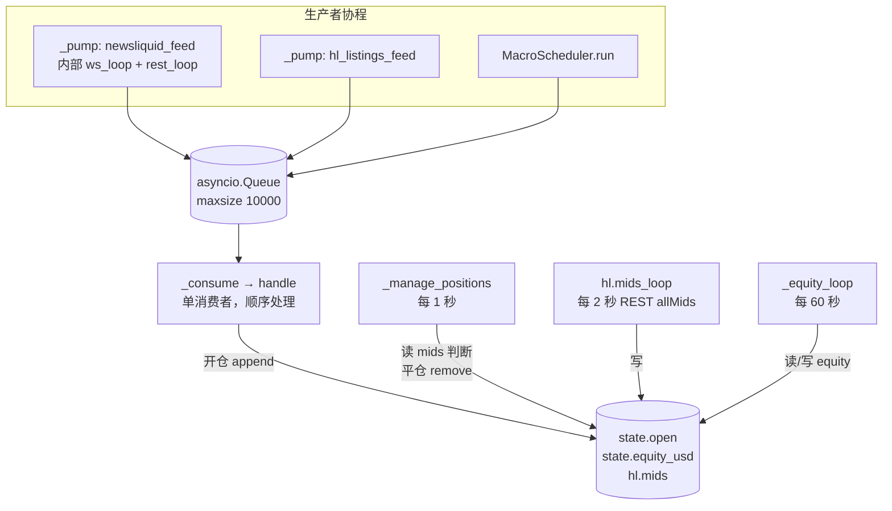

关键性质：

- **单消费者**。`_consume` 一次只处理一条新闻。分类是纯计算（<1 毫秒），开仓时的盘口查询和下单会让后面的新闻多等几百毫秒，对这个策略可以接受。要改成并发消费需要给 `Corroboration` 和 `state.open` 加锁。
- **NewsLiquid 源内部还有两个协程**：`ws_loop` 和 `rest_loop` 共用一个内部队列和一个"已见 id"集合，所以同一条新闻从 WS 和 REST 各来一次也只会出现一次。
- **`state.open` 的竞争**。`handle` 追加、`_manage_positions` 删除，两者都在事件循环里且没有 `await` 穿插在读写之间，所以不需要锁。
- **行情是拉不是推**。所有决策都基于 `hl.mids`，它每 2 秒更新一次。这意味着止损判断最多滞后 2 秒加 RTT。live 模式下交易所侧止损单是第一道防线，本地判断是第二道。
- **HL 请求有一把锁**。`open_position`/`close_position` 的交易所调用在 `asyncio.Lock` 内，避免同一 API 钱包并发签名撞 nonce。

---

## 8. 日志怎么读、数据库怎么查

### 日志行

```
OPEN PAPER long BTC size=0.00828 @ 80506.6992 notional=$667 (0.33x equity, margin lev 2x) stop=79292.9925 tp=82513.0125 hold=3600s news_age=285190.4s slip=0.8bps
```

| 片段 | 含义 |
|---|---|
| `PAPER` | 模式 |
| `long BTC size=0.00828 @ 80506.6992` | 方向、币、数量、成交价 |
| `notional=$667` | 名义价值 |
| `0.33x equity` | 名义是权益的 0.33 倍（风控算出来的实际敞口） |
| `margin lev 2x` | live 模式会设给交易所的杠杆（paper 只是记录） |
| `stop / tp` | 止损价、止盈价 |
| `hold=3600s` | 时间止损，60 分钟 |
| `news_age=285190.4s` | 新闻源时间戳到本机处理的延迟。回放时这个数没意义；实时跑时 WS 推送应在几秒以内，REST 轮询会再多 0–15 秒 |
| `slip=0.8bps` | 盘口估算的滑点 |

```
REJECT macro_cpi short BTC: per-coin cooldown BTC
```
风控拒绝，原因是第 4.6 节表里的 11 种之一。

```
waiting for a second source (Twitter, 1 so far) nl_news long ETH: ...
```
不是拒绝，是等第二个来源。窗口内没来就自然过期。

```
NewsLiquid WS subscribed {"engineTypes": {"news": [], "listing": []}, "hasCoin": true}
NewsLiquid WebSocket refused (401); REST polling carries the feed; retry in 30 min
NewsLiquid REST refused: HTTP 401 {"error":"invalid token","success":false} (token invalid, or the plan does not include news_search)
NewsLiquid WebSocket missed 2 rated item(s) that REST returned
NewsLiquid quota / rate limit: HTTP 429 ...; pausing REST for 10 min
```
NewsLiquid 源的状态：WS 订阅成功；WS 被拒改走 REST（`auto` 模式下套餐不含推送时就是这样，不用管）；token 无效；抽查发现推送漏条；额度用完或限流。

```
CLOSE PAPER long BTC @ 80502.0000 reason=stop pnl=$-10.42 fees=$0.60 equity=$1989.58
```
`reason` 是 `stop` / `take_profit` / `time_stop` / `pre_maintenance` / `shutdown` 之一。`pnl` 已扣双边手续费。

```
HALTED: daily loss 3.1%
```
熔断。之后所有信号都会被 `halted:` 拒绝，直到 UTC 零点（日亏）或重启进程（下单失败）。

```
MACRO RELEASE BLS: CPI YoY ACTUAL 3.4% (FORECAST 3.1%); ...
armed cpi consensus={'yoy': 3.1, 'core_yoy': 2.6} release at 2026-10-14T12:30:00+00:00
```
宏观调度器的两个关键时刻。

### 常用查询

```sql
-- 拒绝原因分布：调参的起点
select reason, count(*) from decisions where accepted=0 group by reason order by 2 desc;

-- 每类事件的分类分布
select event_class, direction, lane, count(*) from classifications group by 1,2,3 order by 4 desc;

-- NewsLiquid 各来源的条目量和延迟（实时跑时）
select channel, count(*), round(avg(age_s),1) avg_age_s, round(max(age_s),1) max_age_s
from news where source='newsliquid' group by 1 order by 2 desc limit 30;

-- NewsLiquid 的 AI 评分延迟（WS 推送时才有 first_seen）
select channel, count(*),
       round(avg(json_extract(raw,'$.nl_rated_ms') - json_extract(raw,'$.nl_first_seen_ms'))/1000.0, 1) ai_delay_s
from news where source='newsliquid' and json_extract(raw,'$.nl_first_seen_ms') is not null group by 1;

-- 已平仓按退出原因
select event_class, exit_reason, count(*), round(sum(pnl_usd),2), round(avg(pnl_usd),2)
from positions where exit_ms is not null group by 1,2;

-- 待复核：有方向但没到门槛的（70–80 分）
select n.title, c.event_class, c.direction, c.confidence, c.reason
from classifications c join news n on n.id=c.news_id
where c.lane='newsliquid' and c.direction!='none' and c.confidence between 0.7 and 0.8
order by n.recv_ms desc limit 50;
```

最后一条是 paper 期间每周要看的：70–80 分、有方向但没交易的新闻，之后的价格是否真的按方向走了。如果 75 分的和 85 分的一样准，就把门槛放低；如果某个来源的条目总是错，就把它加进二源名单或从订阅里拿掉。

---

## 9. 从 paper 到 live 的三道门

| 阶段 | 做什么 | 通过条件 |
|---|---|---|
| **Paper**（现在） | 真实新闻 + 真实价格 + 模拟成交。每周看 decisions 表和第 8 节的复核查询 | ≥60 个信号；按事件类、分数段、来源统计胜率和 R 倍数；评分方向与随后价格方向的一致率明显高于 50% |
| **Testnet** | `network: testnet`，走真实下单路径 | 100 笔下单无异常；验证 nonce、价格舍入、止损单触发、HIP-3 逐仓、取消挂单 |
| **Live 小仓** | 1,000–3,000 USDC，`max_risk_per_trade_pct: 0.5` | ≥100 笔；期望为正；`userFills` 实际成交价与 paper 滑点估计偏差 <2 倍 |

### Live 配置步骤

1. 在 app.hyperliquid.xyz/API 创建 **API wallet**（又叫 agent wallet）。它只能签单，不能提币，最多 1 个未命名 + 3 个命名，有效期最长 180 天。
2. 把私钥和主账户地址放进环境变量：
   ```bash
   export HL_AGENT_KEY=0x...   # API wallet 私钥
   export HL_ACCOUNT=0x...     # 主账户地址（钱在这里）
   ```
   或写进 `.env` 并 `source`。`.env` 在 `.gitignore` 里，`.env.example` 是模板。
3. `config.yaml` 改 `mode: live`。`account.equity_usd` 会被链上权益覆盖。
4. 如果账户是统一账户模式（app 里设置过），改 `unified_account: true`。
5. **一个进程一个 API wallet。** SDK 用毫秒时间戳当 nonce，没有计数器，两个进程共用一个 key 会撞 nonce 被拒。
6. 如果交易 HIP-3 标的且是标准账户模式，确保 xyz dex 里有余额（标准模式下每个 dex 独立余额，用 app 或 `send_asset` 转）。

### Testnet

`network: testnet` 指向 `api.hyperliquid-testnet.xyz`。水龙头在 app.hyperliquid-testnet.xyz/drip，给 1,000 测试 USDC，但**要求同一地址在主网存过款**。testnet 上 xyz 的 dex 序号是 65 而不是 1，资产 ID 不同，代码按名字解析所以不受影响。

---

## 10. Hyperliquid 的几个坑，以及代码里对应的处理

| 坑 | 后果 | 代码里的处理 |
|---|---|---|
| SDK 市价单默认滑点 5% | 极端行情下 IOC 限价离 mid 5%，会成交在深渊 | `market_slippage: 0.003`，自己算限价 |
| 标记价含 150 秒 EMA，止损按标记价触发 | 盘口已穿止损、标记价没到，交易所侧止损不触发 | `_manage_positions` 每秒按 mid 做第二道判断 |
| IOC 在排序上永远排在同一时刻的撤单和 ALO 后面 | 新闻瞬间做市商先撤单，你的吃单成交价比看到的差 | 成本/止损比 35% 门槛；paper 滑点估计偏乐观，实盘头两周要对比 `userFills` |
| 每周五升级，08:00–09:30 UTC 只挂单窗口 | IOC 不成交，市价止损不执行 | `maintenance_window`：前 5 分钟全平，窗口内不开 |
| `Info` 不传 `perp_dexs` 就解析不了 `xyz:TSLA` | KeyError | `start()` 显式传 `["", "xyz"]` |
| 价格精度：5 位有效数字 + 小数位 ≤ 6−szDecimals | SDK `float_to_wire` 抛异常 | `_round_px` / `_round_sz` |
| 同一毫秒两次签名撞 nonce | 第二单被拒 | `asyncio.Lock` 串行化交易所调用；一进程一钱包 |
| HIP-3 部分标的 `onlyIsolated` | 全仓下单被拒 | `only_isolated` 表，自动逐仓 |
| 统一账户模式下各 dex 单独状态无意义 | 权益算错 | `unified_account` 开关 |
| 交易所杠杆 = 保证金杠杆，不是敞口 | 设成 1x 时第二个持仓保证金不够 | `Decision.leverage` 用模板上限 |
| IP 限速 1,200 权重/分钟；连续十几次 POST 会 429 | 行情中断 | 两个 dex 之间 sleep 0.6s；meta diff 之间 sleep 1.5s；轮询 2s |
| OI 上限（xyz 每币有名义上限） | 下单返回 `PositionIncreaseAtOpenInterestCap` | 当作一次下单失败，不重试 |
| ADL（自动减仓） | 盈利仓位可能被交易所强制平掉 | 无法防御，接受 |
| 周末 HIP-3 预言机是内部 EMA + 发现边界 ±(1/杠杆) | 永续被钉在真实缺口之下；SKHX 事件 2.7 秒内清算 | 股票模板 max_lev 2x；周末持仓需按周一缺口想止损（当前未特殊处理） |

---

## 11. 怎么改：调门槛、改来源、加模板、加一手数据源

### 调门槛

- 交易门槛：`templates.nl_news.min_conf` 和 `templates.nl_news_stock.min_conf`（0.8 = 80 分）。
- 方向门槛：`rating.min_score`（默认 60），低于它只落库。
- 控制台"控制与配置"页可以直接改这两类数字。

### 改订阅的来源

`feeds.newsliquid.engine_types` 是引擎到来源代码的映射，`[]` 表示该引擎的全部来源：

```yaml
feeds:
  newsliquid:
    engine_types:
      news: ["Bloomberg", "Reuters", "jin10", "BWEnews"]   # 只要这几个新闻源
      listing: []                                         # 全部上币公告
      market: []                                          # 加订行情异动（没有模板，只落库）
```

完整的来源代码表用 token 调 `GET https://ai.6551.io/open/news_type`。`coins` 可以只订部分标签（如 `["BTC", "ETH", "XYZ-NVDA"]`），能省一点额度。

### 改二源名单

`rating.require_two_sources_for`，写 NewsLiquid 的 newsType（不分大小写）。控制台里也能改。从名单里删掉某个来源，意味着它的单条高分消息可以直接开仓；只删你确认从不发假消息的来源。

### 加交易的类别或标的

- 让 `nl_market` 这类引擎也能交易：订阅它（`engine_types` 里加），再在 `templates` 里给它加一行。
- 加股票或币：`universe.crypto` / `universe.stocks` 里加 HL 合约名（如 `xyz:AMD`），NewsLiquid 的 `XYZ-AMD` 标签会自动映射；名字对不上的写进 `universe.symbol_map`。

### 加一手数据源

像 BLS 那样自己采、自己用算术判断的数据，比如 FOMC 声明页：

1. 在 `feeds.py`（或一个新模块）写一个 `async generator`，yield `NewsItem`，把解析出的数字放进 `raw`。
2. `models.EventClass` 加枚举值；`classify.classify()` 加一个分支，按 `raw` 里的数字返回 `Classification`（`lane` 自己起名）。
3. `config.yaml` 的 `templates` 加一行；`run.py` 里把源加进 feed 列表。
4. `data/replay.jsonl` 加一条对应的记录，跑回放和测试确认。

---

## 12. 已知限制与未做的事

- **不能按事件类型区分持仓。** NewsLiquid 只给分数和方向，不给"这是黑客 / 关税 / 财报"的类型，所有新闻共用 `nl_news` / `nl_news_stock` 两个模板。旧版能给 CPI 30 分钟、黑客 90 分钟、财报 2 小时，现在只有宏观直采还能这样。
- **评分的准确率没有独立验证。** NewsLiquid 公布的准确率和延迟都是自报的。paper 阶段就是在测它。
- **没有逐币评分的条目，多资产时不交易。** 免费热榜就是这种形状；按 NewsLiquid 文档，实时推送和 REST 都带逐币评分，所以影响应该很小，但要在实盘数据里确认（看 `classifications.reason` 里有多少 `item rating not applied`）。
- **覆盖面跟着 NewsLiquid 走。** 它的 55 个新闻源里没有日经、华尔街见闻、财联社；东芝 HDD 那类只在日经首发的股票新闻可能收不到，或者要等转述。
- **延迟取决于套餐。** 非 Max 套餐走 REST，平均多等 7.5 秒；AI 评分本身的延迟还没测过（`raw.nl_first_seen_ms` / `nl_rated_ms` 会记录）。
- **依赖第三方服务。** NewsLiquid 停服、改字段或改价，新闻输入就断；`feed` 报警会通知，宏观直采和上币探测不受影响。额度的计量单位也没有公开文档说清楚，见第 15 节。
- **FOMC 直采未实现。** 美联储决议只作为 NewsLiquid 新闻进来。
- **止盈是单目标全平。** 没有分批、没有移保本。
- **行情是 2 秒 REST 轮询**，不是 WebSocket。止损判断滞后最多 2 秒 + RTT。
- **paper 滑点模型偏乐观。** 它按当前静态盘口算，没有模拟新闻瞬间的撤单。
- **周末 HIP-3 没有特殊模板。** 第二部分 B2.4 节的"周末缺口"策略还没写。
- **回测器只覆盖 BTC/ETH。** HIP-3 标的没有免费的分钟级历史。
- **Hyperliquid builder code 没有接**（SDK 支持，需要在 `order()` 调用里传 `builder=`）。

---

## 13. 常见问题

**跑了一小时什么都没发生，正常吗？**
正常。默认门槛 80 分，2026-10-28 那一天的热榜里只有 1 条 news 引擎的条目到 80 分，而且因为同时标了多个资产没有交易。看 `data/hlnews.log` 里有没有 `NewsLiquid WS subscribed`（或者 REST 在轮询、没有报错）和 `macro schedule loaded`；用 `sqlite3 data/hlnews.db "select count(*) from news where source='newsliquid'"` 确认新闻在进。

**日志里有 `NewsLiquid WebSocket refused (401)`？**
两种可能：token 无效（REST 也会报 `auth_fail`），或者套餐不含实时推送（REST 正常在跑）。`auto` 模式下后者不用管，30 分钟后会再试一次 WS；确定没有 Max 套餐，可以把 `transport` 改成 `rest`。

**报警说"额度用完或被限流"？**
REST 会暂停 10 分钟再试。按套餐调 `poll_s`（第 15 节有表），并到 MCP 页面看实际消耗。

**日志里一直 `waiting for a second source`，然后就没了？**
推特、Telegram 这类来源的单条消息要等另一个来源在窗口内同向确认。如果你确认某个来源可靠，从 `rating.require_two_sources_for` 里删掉。

**很多新闻有方向，但没有信号？**
分数没到模板门槛（默认 80）。判断都在 `classifications` 表里，第 8 节最后一条查询能列出来。

**`stale/no price` 拒绝？**
`hl.mids` 超过 15 秒没更新。看日志有没有 `allMids failed`，通常是网络或 429 限速。

**回放时 `news_age` 是几十万秒？**
回放条目的时间戳是 NewsLiquid 的原始发布时间（或示例数据的固定时间），和当前时间比没有意义。只有实时跑时这个数才反映真实延迟。

**paper 的盈亏能信吗？**
方向和时间逻辑可以信，成交价偏乐观（见第 12 节）。把它当作"策略逻辑是否成立"的测试，不是收益预估。

**为什么 CPI 的 FORECAST 没有值（`FORECAST None%`）？**
ForexFactory 的周历只覆盖本周。如果 FF 当周 JSON 里标题不是 "CPI y/y"（偶尔会变），共识就是空的，标题会写成 `FORECAST None%`。`classify_macro` 在共识缺失时返回 `CPI release without number or consensus`，不交易。

**想只交易 BTC/ETH 不碰股票？**
`universe.stocks: []`，`hyperliquid.perp_dexs: [""]`。

**Mac mini 上怎么常驻？**
`launchd` 用户代理，`KeepAlive: true`，`WorkingDirectory` 指向仓库，`ProgramArguments` 是 `.venv/bin/python -m hlnews.run`，`StandardOutPath`/`StandardErrorPath` 指向日志。`OPENNEWS_TOKEN` 等环境变量用 `EnvironmentVariables` 字典传，不要写进 plist 以外的地方。

---

# 第二部分：Hyperliquid 新闻交易永续合约 bot：架构设计与可行性结论

> 2026-10-01 · 对象：BTC / ETH 永续 + trade.xyz 股票永续（TSLA、NVDA、MU 等）· 新闻源以免费为主 · Python · Mac mini M2 常驻。本部分是设计文档全文，章节号加 B 前缀以区别于第一部分。

> **2026-10-28 注：** 本部分是 2026-10-01 的原始设计。B3 里的免费源方案、B4.1–B4.3（采集、去重与佐证、双车道分类）描述的自建爬虫和规则 / LLM 分类器已被 NewsLiquid 取代，见第一部分第 4 节和第 15 节；B5 的事件类模板已合并为 `nl_news` / `nl_news_stock`（第 6 节）。延迟证据、风控、执行、最小资金和验证路线仍然适用。

## B0. 先说结论

用免费新闻流做 Hyperliquid 新闻交易，系统可以搭起来并取得正期望，收益来源是新闻后的"二次反应"而非"第一跳"。本周实测 Tree of Alpha 免费 WebSocket 对推特的延迟中位数 0.56 秒，这已经是免费档里最快的，而 CPI 这类定时数据在发布后 15 秒内已走完 5 分钟行情的 85–90%。所以这套系统的设计目标被定为：在新闻发生后 5–60 秒内进场，持有 30 分钟到 2 小时，吃事后延续或事后反转，严格限制单笔风险。

对附加的两个问题，本文第 B8、B9 节给出数字：

- 最小账户金额：数学下限约 300 USDC，固定成本线约 2,000–3,000 USDC，建议先 paper 2–3 个月再以 1,000–3,000 USDC 上实盘。
- "公开、已验证、年化 200%+"的新闻交易方案：没有找到任何一个同时满足"公开 + 可审计 + 可复现 + 免费数据源"四个条件的。能查到的高收益案例分三种：付费同机房行情 + 上币抢跑（作者本人已宣告失效）、事前建仓（信息优势）、两周样本（nof1 Alpha Arena 冠军 Qwen 两周 +22.9%，下一季四场全亏）。200% 年化在数学上要求每笔交易净赚权益的 0.44%（250 笔/年）或 0.92%（120 笔/年）。按 1.5 倍盈亏比、50% 胜率、250 笔/年做蒙特卡洛：单笔风险 2% 时一年收益中位数 +222%，达到 200% 的概率 57%，最大回撤中位 18%；要把概率提到九成需要单笔风险 4%，代价是最大回撤中位 34%、6% 的路径回撤超过 50%。胜率降到 45% 时，2% 风险的中位收益只剩 +69%。本文给出的是数据能支持的推进路线，没有 200% 的配方。

随附的 `hl-news-bot/` 目录是一套能跑的 paper 模式骨架，已经接通真实新闻流和真实 Hyperliquid 价格，并带事件回测器。

---

## B1. 目标、边界与边际来源

### B1.1 交易什么

| 市场 | 标的 | 最大杠杆 | 维持保证金 | 吃单费（基础档） | 备注 |
|---|---|---|---|---|---|
| 验证者永续 | BTC | 40x | 1.25%（>1.5 亿 U 名义降 20x） | 0.045% | szDecimals 5，价格整数 tick |
| 验证者永续 | ETH | 25x | 2%（>1 亿 U 降 15x） | 0.045% | szDecimals 4 |
| HIP-3 `xyz` | TSLA / NVDA / META / AAPL / MSFT / GOOGL / AMZN | 20x | 2.5% | 0.009%（成长模式）/ 0.09%（标准） | 可全仓 |
| HIP-3 `xyz` | MU / SNDK / SKHX / SKHY | 10x | 5% | 同上 | 可全仓 |
| HIP-3 `xyz` | INTC / PLTR / COIN / HOOD / MSTR / AMD 等 | 10x | 5% | 同上（MSTR 不适用成长模式，0.09%） | 仅逐仓 |
| HIP-3 `xyz` | SP500（50x）、XYZ100（30x）、GOLD/SILVER（25x） | | | | 指数外盘时段跟期货 |

HIP-3 上 trade.xyz 占股票永续成交的约 95–98%，Felix、Ventuals、Kinetiq(USDH)、dreamcash 的部署在 2026 年中已全部下架。API 里的名字固定为 `xyz:TSLA` 形式，资产 ID = 100000 + 10000 × dex 序号 + 序号（`xyz:TSLA` = 110001）。

### B1.2 边际从哪来，从哪不来

用免费源，延迟档位是 0.5–30 秒。据此划分：

能做的：
1. 定时宏观数据的残余行情。CPI 发布后 1 分钟已走完 30 分钟行情的 76%，但剩下 24% 的方向在 83% 的事件里与第一分钟一致。NFP、FOMC 第一分钟只走完 36–38%，但有 23–27% 的概率在 30–60 分钟内翻转，所以模板要更保守。
2. 非计划冲击的延续。Bybit 被盗（14.6 亿美元）从链上被盗到 ZachXBT 公开发帖隔了 64 分钟，发帖后 ETH 5 分钟 −1.36%、15 分钟 −2.65%、30 分钟 −4.07%。特朗普 2025-03-02 储备帖 BTC 第 1 分钟只有 +0.2%，第 5 分钟 +2.3%，第 60 分钟 +4.3%。2025-10-10 关税帖 5 分钟 −1.7%，真正的 −12% 来自 20–30 分钟后的杠杆清算潮。这类事件的"第二跳"持续分钟级，免费源够用。
3. Hyperliquid 自己的新上币（通过 `meta` 接口 diff 发现，零延迟，和所有人同时知道）。
4. HIP-3 股票永续周末内部时段的重新定价（第 B2.4 节）。

不做的：
1. 币安 / Upbit 上币抢跑。Binance CMS 接口从数据中心 IP 连发 12 次就 403 并持续 15 分钟以上；Upbit 公告接口对海外 IP 返回 403；付费同机房源每月 200–2,500 美元；研究显示 28–56% 的上币公告前已有内幕建仓，Binance 现货上币 14 天峰值相对首日收盘的中位数只有 +0.9%。这个赛道的边际已被钱和信息优势占满。
2. 毫秒级任何东西。Hyperliquid 自身在 BTC/ETH 价格发现上落后 Binance 约 800 毫秒，IOC 吃单在排序上永远排在同一时刻的撤单和 ALO 挂单之后。
3. 财报后前 10 秒。学术证据（Christensen 等 2025，S&P 500 前 50 名，2008–2020）：按意外符号交易，5 秒延迟后收益 0.41%，10 秒延迟后 0.28% 且不显著，2016–2020 子样本在最优报价上也不显著。xyz 的 MU 在 2026-09-30 财报夜与纳斯达克盘后在同一分钟触底、同一分钟反弹，没有可见的领先或滞后。

---

## B2. 证据：新闻之后价格多快走完

以下数据除标注外均为本次用 Binance 1 分钟 K / aggTrades 自行计算（宏观统计覆盖 2024-01 至 2026-09，个别事件早于此），事件时间取 UTC。

### B2.1 定时宏观

| 事件 | n | +1m | +5m | +15m | +30m | +60m | +4h | 发布分钟成交量 / 前 5 分钟均值 |
|---|---|---|---|---|---|---|---|---|
| CPI（08:30 ET，即 12:30/13:30 UTC） | 32 | 0.47% | 0.46% | 0.50% | 0.48% | 0.65% | 1.40% | 25x |
| NFP | 32 | 0.21% | 0.28% | 0.37% | 0.51% | 0.44% | 1.10% | 16.5x |
| FOMC 声明 | 22 | 0.28% | 0.41% | 0.37% | 0.42% | 0.70% | 0.68% | 7.8x |
| 对照（前一周同一时刻） | 32 | 0.06% | 0.12% | 0.14% | 0.17% | 0.29% | 0.78% | 1.2x |

表中为 BTC 从发布分钟开盘价算起的绝对收益中位数。亚秒级：2025-02-12 CPI 偏热，发布后 5 秒 −0.67%，15 秒 −1.38%，5 分钟 −1.67%。

### B2.2 非计划冲击

| 事件 | 时间锚 | +1m | +5m | +15m | +60m | +24h | 备注 |
|---|---|---|---|---|---|---|---|
| Bybit 被盗，ETH | ZachXBT 发帖 15:20 | −0.14% | −1.36% | −2.65% | −2.46% | −2.83% | 链上 14:16 被盗，64 分钟无人定价 |
| 特朗普加密储备帖，BTC | 15:24 | +0.2% | +2.3% | +3.6% | +4.3% | +7.1% | 约 30 小时后全部回吐 |
| 90 天关税暂停，BTC | 17:18 | −0.66% | +2.21% | +3.89% | +5.20% | +0.75% | 前 30 秒无反应 |
| 100% 对华关税帖 #2，BTC | 20:50 | −0.40% | −1.70% | −2.25%（10m） | −3.2% | −5.6% | 21:13–21:20 清算潮到 −12.7% |
| 假 SEC 推文，BTC | 21:11 | +1.25% | +2.7%（峰值 4m） | −4.2%（14m） | | −1.2% | 辟谣前已开始反转 |
| ETH ETF 概率上调推文 | 19:20 | +0.34% | +4.49% | +7.63% | +9.06% | +18.6% | 真实重定价，无反转 |

结构性结论：非计划冲击的第一个极值通常在发帖后 2–5 分钟出现，免费源 1–20 秒的延迟吃得到；但反转是常态（假 SEC 15 分钟内走完来回，储备帖 30 小时回吐，关税暂停次日回吐），所以持仓窗口必须有硬性时间止损，止盈必须分批。

### B2.3 上币

| 来源 | 数字 |
|---|---|
| IOSG 2025-06，Binance 现货上币 14 天峰值 vs 首日收盘 | 均值 +15%，中位数 +0.9% |
| CoinGecko 2026 CEX 报告（2025-01 至 2026-02） | 上币后短期只有约 32% 上涨；12 个月后 <10% 高于上币价 |
| Ante 2019，327 次上币 | Upbit 上币日 −2.9%（p<0.05），仅 20% 为正 |
| Félez-Viñas 等 2025 | Coinbase 公告前约 250 小时开始提前上涨，28–48% 的上币有内幕交易特征 |
| 2025 年 Upbit 公告反应 | CAP 1 分钟内 +34.5%，BIGTIME 1 分钟 +35% |

上币的钱在前 1–60 秒，并且做这件事的人用的是 Tokyo/Seoul 同机房接入。这不是本系统的目标。

### B2.4 美股与 HIP-3 股票永续

盘后价格发现：财报日 80% 的全天价格发现发生在 16:00–18:30 盘后时段，其中约 70% 在前 5 分钟完成（Christensen, Timmermann & Veliyev 2025）。xyz 的外部定价在周日 20:00 ET 到周五 20:00 ET 之间 24/5 覆盖盘前、盘中、盘后以及 Blue Ocean ATS 的夜盘（20:00–04:00），所以财报夜 xyz 永续跟着盘后成交走，不存在"永续先动"的结构性窗口。

周末内部时段是唯一结构性独特的窗口：周五 20:00 ET 到周日 20:00 ET，预言机由永续自己订单簿的冲击价差驱动的 EMA（时间常数 30 分钟）推进，标记价被限制在参考价 ±(1/最大杠杆) 的发现边界内（TSLA/NVDA ±5%，MU ±10%，SP500 ±2%），可重锚 0–2 次。

| 来源 | 周末最终价比周五收盘更接近周一开盘参考价的比例 |
|---|---|
| Messari 2026-08，614 个市场-周末，跨资产 | 70.7%；周一开盘变动 >100 bps 时 86%，<25 bps 时 31% |
| Hyperliquid Research Collective，23 个股票市场 191 个周末 | 50.7%，中位改善 0.4 bps；周末挂单深度为工作日 33.9% |
| Crypto.com Research，52 周 | 周日 22:00 方向准确率 NVDA 78.9%、TSLA 52.6%；但周日夜对冲 P&L 为负 |

含义：单只股票的周末定价整体与周五收盘打平，只有当周末真有 >50–100 bps 的新闻时永续才明显领先。这正好是新闻 bot 能用的：周末出现针对某只股票的重大新闻时，在周日 20:00 ET 外部定价恢复前进场，赌重新开盘的缺口。风险是发现边界（±5%）可能把永续钉在真实缺口之下，以及 SK 海力士 2026-07-27 事件：一笔稀薄的韩股盘前成交被中继进预言机，标记价 −18.4%，预言机更新后 2.7 秒开始清算，一分钟内清算 5,180 万美元。

### B2.5 Hyperliquid 执行面的事实

| 项目 | 实测/文档 |
|---|---|
| BTC 永续点差 / 顶档 | 0.12 bps（$1 tick）/ $30–90 万 |
| BTC ±0.1% 深度每侧 | $1,800–2,300 万；$1M 市价单滑点 0.6–2.1 bps，$10M 2.5–4.3 bps |
| ETH ±0.1% 深度每侧 | $900–1,000 万；$1M 滑点 1.9–4.1 bps |
| xyz:TSLA ±10 bps 深度（本次实测） | 买侧 $29.5 万 / 卖侧 $26.4 万 |
| 端到端延迟（官方，同地） | 中位 0.2 秒，p99 0.9 秒；区块约 70–80 ms |
| 本机到 API RTT（深圳经代理） | 0.30–0.51 秒 |
| 2025-10-10 极端行情 | HL BTC 比 Binance 永续多插 0.7%，ETH 多插 4.7%；CEX 可见深度跌 98%；标记价含 150 秒 EMA，清算/止损触发价滞后于盘口 |
| 排序规则 | 同一时刻发出的撤单和 ALO 几乎总在 IOC/GTC 之前成交 |
| 市价单 | 实为 IOC 限价；SDK 默认滑点容忍 5%（必须收紧） |
| 每周升级 | 周五 08:00–09:30 UTC 有 9–20 分钟只挂单窗口，市价单不成交 |

---

## B3. 信息流分层与延迟预算

### B3.1 可用源（2026-10-01 全部实测过）

| 层 | 源 | 接入 | 费用 | 相对原始事件的延迟 | 用途 |
|---|---|---|---|---|---|
| T0 | Tree of Alpha 主 WS `wss://news.treeofalpha.com/ws` | WebSocket，无需登录 | 免费（付费档解锁交易所公告专线） | 推特中位 0.56 s，p90 1.0 s；Binance EN 1.26 s；推送 Truth Social `type: direct` | 主力：推特、博客、usGov、Truth Social |
| T0 | @BWEnews Telegram | Telethon 用户会话 | 免费 | 约 2 s（含币安公告中继） | 上币/交易所公告中继，中英双语 |
| T0 | @CLWfeed Telegram / cryptolisting.ws FreeDelayed | Telegram 或 WS key | 免费（+240 ms 档） | 约 1 s | Upbit/Bithumb/Robinhood 公告，海外唯一稳定渠道 |
| T0 | Hyperliquid `meta` / `perpDexs` diff | REST 轮询 5 s | 免费 | 0（和所有人同步） | HL 新上币 |
| T0 | Polymarket CLOB WS | WebSocket | 免费 | 秒级 | 宏观/政治事件的事前共识 |
| T1 | bls.gov 发布页 / Fed 新闻稿 URL 定时轮询 | REST，需带联系方式的 UA | 免费 | 1–3 s | CPI/NFP 数字本身（解析器已实现并对当前页面验证）；FOMC 声明轮询未实现 |
| T1 | SEC EDGAR `getcurrent` Atom（8-K） | REST，≤10 req/s | 免费 | 秒级到 1 分钟 | 财报 8-K Item 2.02、重大协议 1.01 |
| T1 | PR Newswire RSS | REST 5–10 s | 免费 | <30 s | 公司新闻稿（Business Wire 公共 RSS 已停） |
| T1 | Bybit / OKX 公告 API | REST 1–2 s | 免费 | OKX 比排定时间晚约 12 s 发布 | 交易所公告备份 |
| T2 | trumpstruth.org RSS | REST | 免费 | 分钟级 | 仅作上下文（官方 Truth API 月费 10 万美元） |
| T2 | X API 过滤流 | 按读计费 $0.005/条 | 约 $90/月（30 账号） | P99 4–5 s | 比 ToA 慢且贵，不推荐 |
| 辅 | ForexFactory 周历 JSON | REST，缓存 60 s | 免费 | 只有预期值，无实际值 | 宏观共识（已实现） |
| 辅 | Claude Haiku 4.5 / GPT-5 nano | API | 每千条 $0.25–0.48 / $0.04 | 首 token 0.6 s，整体 0.5–2 s | 慢车道解读 |

被排除的：Binance CMS 直连（WAF 封 15 分钟以上）、Upbit 公告 API 直连（海外 403，官方 WS 需韩国 KYC）、Investing.com（Cloudflare）、Alpha Vantage（每日 25 次）、Whale Alert（无免费 API）、Phoenix News（价格不公开）。

### B3.2 延迟预算

```mermaid
gantt
    title 一条非计划新闻从发生到我方成交（典型，毫秒）
    dateFormat x
    axisFormat %Q
    section 外部
    事件发生到源发布（推特/博客）        :a1, 0, 560
    section 本机
    WS 接收 + 解析 + 去重                 :a2, 560, 580
    规则快车道（正则/数字）               :a3, 580, 582
    LLM 慢车道（可选，仅规则不确定时串行）  :a4, 582, 1800
    盘口拉取 + 滑点估计 + 风控            :a5, 582, 1000
    section Hyperliquid
    IOC 下单往返（深圳→API）              :a6, 1000, 1500
    区块确认                              :a7, 1500, 1700
```

规则车道走完全程约 1.7 秒（受本机到 API 的 0.3–0.5 秒 RTT 支配）；规则低于门槛时串行调用 LLM，全程约 2.5–3.5 秒，等待期间并行刷新一次行情。两者都远慢于 CPI 的 15 秒走完 85%，但都快于非计划冲击 2–5 分钟的第一个极值。若将来追求 T0 事件，把执行进程搬到东京 VPS 可省 0.3–0.4 秒，但新闻源本身的 0.5–2 秒不会变，所以此项优先级靠后。

---

## B4. 总体架构

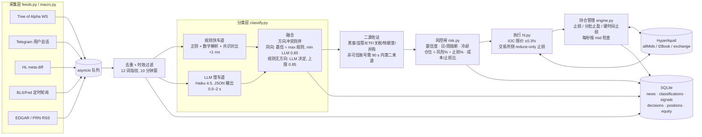

### B4.1 采集层

每个源是一个 `async generator`，产出统一的 `NewsItem`（来源、子频道、账号、标题、原始时间戳、本机接收时间、源给出的币种建议）。Tree of Alpha 的 REST 历史接口和 WS 推送的消息结构不同（WS 的 Truth Social / 推特直推是 `{title: "Name (@handle)", body, link, type: "direct", info{twitterId, truthId}}`，没有 `source` 字段），解析器两种都处理，这是本周实跑时踩到并修掉的。所有源的 WS 断线按指数退避重连（Hyperliquid 官方 SDK 的 WebSocket 管理器没有重连逻辑，这里的行情走 REST 轮询加自己的重连）。

时效过滤在引擎入口对所有实时源统一做：原始时间戳距今超过 20 秒的直接丢，避免重连后补发的旧消息触发交易（回放源除外）。

### B4.2 去重与佐证

同一条新闻会从推特、博客、Telegram 以 3–8 个版本在几十秒内到达。指纹取标题小写、去链接、去 "Name (@handle):" 前缀、去标点后的前 12 个词做 SHA1，10 分钟窗口内相同指纹只处理第一条。

佐证器按（事件类、币种、方向）记录 90 秒内不同来源的数量。黑客、监管、ETF、关税、特朗普、并购这六类，若首发账号不在可信名单（DeItaone、FirstSquawk、WatcherGuru、unusual_whales、CoinbaseMarkets、SECGov、zachxbt、PeckShieldAlert 等）则必须等到第二个独立来源。假 SEC 推文那种单点来源会被这一层挡住一次，由"辟谣反转"规则再挡一次。

### B4.3 分类层：双车道

规则快车道只处理窄而确定的事：CPI/NFP/FOMC 数字与共识的差值（共识由宏观调度器在发布前 15 分钟从 ForexFactory 注入，或直接解析 FirstSquawk 格式里的 FORECAST 值）、黑客金额与涉事交易所、ETF 批准/否决/辟谣、关税升级/缓和、财报 beat/miss 与指引上调/下调。每条规则输出事件类、方向、置信度、标的、是否谣言、是否定时事件。规则车道的置信度上限按来源分两档：可信账号或官方/通讯社来源 0.80–0.85，其余 0.60。对照第 B5 节的门槛，这意味着在不开 LLM 的默认配置下，只有可信来源的黑客/关税/特朗普/财报类、BLS 直采的 CPI/NFP 和 HL 新上币能直接下单，ETF/监管/脱锚类（门槛 0.85）必须经 LLM 车道确认。本周用过去 168 小时的 2,597 条真实新闻跑这条车道：0 条达到直接下单门槛，49 条进入"需要慢车道复核"状态。这个结果一半来自门槛结构，一半来自这一周没有发生可信来源首发的重大事件，不能当作精度证据；精度要靠 paper 期间人工复核 decisions 表得到。

LLM 慢车道在规则给出"无方向"或置信度低于该事件类门槛时串行调用（同时刷新一次行情），用一个 250 token 的系统提示和严格 JSON 输出（事件类、方向、置信度、标的、是否谣言、12 词理由）。融合策略：两车道方向冲突则放弃；规则有方向且 LLM 同向则置信提到 max(规则, min(LLM, 0.85))；规则无方向时采用 LLM 结论但置信封顶 0.85。LLM 永远不能单独把一条新闻推过"可信账号"门槛。

为什么不全靠 LLM：nof1 Alpha Arena 第一季六个模型在 Hyperliquid 上实盘两周，四个亏超过 50%，整体跑输持有 BTC；1.5 季加入新闻源的那一组七个模型中六个为负；学术上 Lopez-Lira 等人的标题策略夏普从 2021 年的 6.5 衰减到 2024 年的 1.2，且在 20 bps 往返成本下不盈利，另有研究估计 LLM 表观预测力的约 37% 来自记忆。LLM 在这里的职责是把"规则没覆盖的措辞"翻译成结构化字段，价格方向的判断仍由模板和历史统计承担。

### B4.4 风控闸

纯函数：输入信号、模板、账户状态、盘口滑点估计，输出接受/拒绝和仓位。拒绝原因全部落库，这是日后调参的主要数据。顺序：是否熔断 → 有无方向 → 置信度 ≥ 模板门槛 → 日亏 ≥3% 或周亏 ≥6% 则停 → 亏损后 15 分钟冷却 → 同币种 10 分钟冷却 → 最多 2 个持仓 → 同币不加仓 → 往返成本（2× 手续费 + 2× 滑点估计）不得超过止损距离的 35% → 仓位 = 权益 × 风险% ÷ 止损%，再被单笔名义上限、模板杠杆上限、币种最大杠杆、总杠杆 3x 四重封顶 → 名义 <12 U 拒绝（交易所最小 10 U）。

### B4.5 执行与持仓

进场用 IOC 限价，价格为 mid ±0.3%（SDK 默认 5%，在 10-10 那种盘口里会以远差于预期的价格成交）。成交后立刻在交易所侧挂 reduce-only 触发止损（`tpsl: "sl"`，`isMarket: true`，触发价参照标记价），时间止损和止盈由本地每秒检查执行。下单前按模板杠杆上限调用 `update_leverage`：BTC/ETH 用全仓（保证金共享，两个持仓可以并存），HIP-3 中 `onlyIsolated` / `noCross` 的标的强制逐仓，其余 HIP-3 标的也用逐仓。交易所侧的杠杆是保证金杠杆，与风控里"名义/权益"的比例是两个量，日志里分开打印。平仓前先撤该币种所有挂单再 `market_close`。

Paper 模式用同一份代码路径，差别只在 `open_position` / `close_position`：按当前 l2Book 逐档吃单估算滑点、按基础档吃单费扣费。

### B4.6 宏观调度器

一天解析一次 BLS 日程页（已验证解析出 10-02 NFP、10-14 CPI）。发布前 15 分钟拉 ForexFactory 共识并注入规则上下文；发布前 2 秒开始以 0.7 秒间隔轮询 `bls.gov/news.release/cpi.nr0.htm`，页面内容相对发布前基线发生变化即解析数字（解析器已对当前页面验证：CPI 同比 3.4、核心 2.4，NFP +162k），生成一条 `usGov` 频道的 NewsItem 进入同一条管线。请求头必须带可联系的 User-Agent，BLS 会封匿名高频客户端。

---

## B5. 事件类与交易模板

| 事件类 | 触发条件（规则车道） | 方向逻辑 | 持有 | 止损 | 止盈 | 单笔风险 | 杠杆上限 | 置信门槛 | 证据基础 |
|---|---|---|---|---|---|---|---|---|---|
| macro_cpi | 解析出实际值且有共识；\|总体差 + 核心差\| ≥0.1pp | 偏热做空 BTC/ETH，偏冷做多 | 30 min | 0.8% | 1.2% | 0.5% | 3x | 0.80 | 2.1 节；回测见 B10.2 |
| macro_nfp | 差值 ≥50k | 强于预期做空 | 60 min | 0.9% | 1.2% | 0.4% | 2x | 0.80 | 第一分钟仅走完 36%，翻转 23% |
| macro_fomc | 决议与预期 bps 不同 | 更鸽做多 | 60 min | 1.0% | 1.2% | 0.4% | 2x | 0.80 | 翻转率高，2025 年 8 次会后 7 次 48h 内为负 |
| hack_exploit | 金额 ≥1 亿美元或涉及头部交易所；排除"追踪/洗钱/恢复/复盘"类跟进报道 | 做空 BTC/ETH（或被点名币种） | 90 min | 1.5% | 2.5% | 0.8% | 3x | 0.80（可信源）| Bybit 案例 30 分钟 −4% |
| depeg | 稳定币脱锚措辞 | 做空 | 90 min | 1.5% | 2.5% | 0.6% | 2x | 0.85 | USDC 2023 为慢跌 4 小时 |
| etf | 批准/否决；"账号被盗/未批准"视为反转 | 批准做多，否决或辟谣做空 | 60 min | 1.5% | 2.0% | 0.5% | 2x | 0.85 | 真批准常为利好出尽 |
| regulatory | SEC/DOJ 起诉、禁令 | 做空 | 60 min | 1.5% | 2.0% | 0.5% | 2x | 0.85 | |
| tariff | 暂停/豁免/协议做多；加征/报复做空 | | 60 min | 1.5% | 2.5% | 0.6% | 2x | 0.80 | 2.2 节 |
| trump_policy | 本人账号或可信中继账号引述，且含加密政策措辞；转发忽略 | 储备/行政令做多，禁令/税做空 | 60 min | 1.5% | 2.5% | 0.6% | 2x | 0.80 | 本人账号 + 一个可信中继即满足二源 |
| listing_hl | `meta` universe 出现新名字 | 等 3 秒看首批成交方向再顺势 | 10 min | 3.0% | 4.0% | 0.3% | 2x | 0.90 | 无公开研究，纯动量假设，仓位最小 |
| earnings / guidance | 金融来源 + 标的在 universe + beat/miss 或 raise/cut 措辞无歧义 | 顺意外方向 | 120 min | 2.0% | 3.0% | 0.6% | 3x | 0.80 | 2.4 节；前 10 秒无边际，赌漂移 |
| m_and_a | 收购措辞 | 规则给不出收购方/标的方向；无模板，LLM 输出仅记录不交易 | | | | | | | |

置信门槛列与规则车道的置信上限对照：可信来源命中给 0.80（CPI 0.85，HL 上币 0.90），非可信来源 0.60。门槛 0.85 的类（ETF、监管、脱锚）在默认配置下只能经 LLM 车道达到。止盈写的是单一目标，实现时建议改为 TP1 减仓一半并移保本（这是你在 HYPE 杠杆标尺那套里已经在用的框架）。

---

## B6. 风控：参数之外的部分

账户层：日亏 3% 停开新仓到 UTC 零点，周亏 6% 停到下周；连续亏损后冷却；价格源超过 15 秒未更新时拒绝新信号；连续 3 次下单失败则熔断停开新仓；已有仓位保留交易所侧止损。新闻 WS 断线只影响信号来源，持仓管理不受影响。

Hyperliquid 特有的几件事要写进代码而不是写进备忘录：

1. 标记价与盘口脱节。标记价含 150 秒 EMA 项，强平和触发单按标记价。极端行情里盘口已经穿过止损价但标记价没到，止损不触发，所以本地按 mid 的时间/价格检查是必须的第二道。
2. 发现边界。股票永续周末标记价被钉在 ±(1/杠杆) 内，清算价在边界外的仓位在边界激活期间无法被清算，重新开盘时一次性兑现。周末持仓的止损要按"周一缺口"而不是"周末盘口"来想。
3. OI 上限。xyz 每币种有名义上限（AAPL 2 亿、AMZN/AMD 1 亿等），触顶时下单返回 `PositionIncreaseAtOpenInterestCap`，视为拒单不重试。
4. 升级窗口。周五 08:00–09:30 UTC 的只挂单窗口里 IOC 不成交，持仓的止损也不会市价成交。要么周五该时段前平掉，要么用限价止损。
5. 排序劣势。IOC 排在撤单之后，意味着新闻瞬间盘口撤单先于你的吃单，实际成交价比看到的差。paper 模式的滑点估计偏乐观，实盘前两周要对比 `userFills` 的实际成交价。
6. ADL。2025-10-10 HL 在 12 分钟内执行 34,983 次自动减仓，盈利方被强制平仓。做对方向也可能被提前平掉。

---

## B7. Hyperliquid 执行细节

API 钱包：在 app.hyperliquid.xyz/API 或用 `Exchange.approve_agent()` 创建，只能签单不能提币，最多 1 个未命名 + 3 个命名，有效期最长 180 天。`/info` 查询永远用主地址。一个进程一个 API 钱包：官方 SDK 用毫秒时间戳当 nonce，没有原子计数器，同一毫秒两次调用或两个进程共用一个 key 会撞；nonce 规则是"每个签名者保留最高的 100 个 nonce，新 nonce 必须大于其中最小值且未用过"，窗口 (T−2 天, T+1 天)。

下单：`{"type":"order","orders":[{a,b,p,s,r,t:{limit:{tif:"Ioc"}}}],"grouping":"na"}`，价格 ≤5 位有效数字且小数位 ≤6−szDecimals（BTC 在 8 万价位上是整数 tick），数量按 szDecimals 截断，SDK 的 `float_to_wire` 对舍入误差直接抛异常，所以要先自己 round。止损用 trigger 订单 reduce-only。`scheduleCancel` 是死人开关（≥5 秒后撤全部，每日 10 次），进程崩溃时有用。

HIP-3：`Info(perp_dexs=["", "xyz"])` 必须显式传，否则 `name_to_asset("xyz:TSLA")` 抛 KeyError（SDK issue #281）。标准账户模式下每个 dex 独立余额，用 `send_asset(source_dex, destination_dex)` 转，权益 = 各 dex `clearinghouseState` 之和；统一账户模式一份 USDC 覆盖全部但每日 5 万次操作上限，此时各 dex 单独状态无意义，只读主状态。代码用 `hyperliquid.unified_account` 开关区分，默认标准模式。`meta_and_asset_ctxs()`、`user_fills()` 等几个方法还不接受 `dex` 参数，需要直接 POST。

限速：IP 1,200 权重/分钟（`l2Book`/`allMids` 权重 2，其余 info 20，`candleSnapshot` 每 60 根加权重）；地址级每累计成交 1 USDC 换 1 次操作，初始 10,000 次缓冲，撤单额外有 `min(limit+100000, 2×limit)` 保底；WS 每 IP 10 连接、1,000 订阅、2,000 消息/分钟。本机实测连续 POST 间隔 1.5 秒不触发 429。

费用：BTC/ETH 吃单 0.045%，推荐码 4% 折扣；xyz 成长模式 0.009%（129 个标的中 118 个开启；GOLD、MSTR 等 11 个不适用），标准 0.09%。止损 0.3% 时 BTC/ETH 往返成本（费 + 2 bps 滑点）占止损距离 43%，止损 1% 时 13%，这是模板止损都 ≥0.8% 的原因。

测试网：`api.hyperliquid-testnet.xyz`，水龙头 1,000 测试 USDC 要求同地址在主网有过存款；xyz 在测试网存在（dex 序号 65，约 70 个标的，极薄），资产 ID 与主网不同，代码按名字解析。

---

## B8. 最小账户金额

三条线分开算。

数学下限约 300 USDC。交易所最小单 10 U；单笔风险 1%、止损 1% 时名义 = 权益，风险 0.5%、止损 1.5% 时名义 = 权益 × 1/3，所以 300 U 的账户在最保守模板下单笔名义 100 U，仍在最小单之上。BTC 最小数量 0.00001（约 0.8 U）、TSLA 0.001（约 0.36 U），不构成约束。地址级限速 10,000 次初始缓冲对每年百笔级别的策略足够。

固定成本线约 2,000–3,000 USDC。免费源 + Mac mini 的边际成本接近零，LLM 慢车道在前置正则过滤后每月 10–40 美元。要让固定成本低于权益的 10%/年，权益需在 2,000 U 以上。若将来加 cryptolisting.ws Basic（200 U/月）之类的付费源，这条线会抬到 2 万 U 以上，这也是"免费为主"路线的内在约束。

统计学费线：真正的约束。区分 60% 胜率和 50% 胜率（单边 95% 置信、80% 功效）约需 150 笔；区分 55% 和 50% 约需 600 笔。按第 B5 节的事件频率（CPI 12 + NFP 12 + FOMC 8 + 非计划冲击 10–20 + HL 上币若干 + 财报季每季 7 只 × 1 次），一年高置信信号大约 60–120 个，所以头一年的样本靠 paper 积累而不是靠真钱。实盘的意义是校准滑点和执行，不是验证边际。按 1% 单笔风险、1.5 倍盈亏比、150 笔，若策略实际胜率只有 35%，期望亏损约 −19%，即 2,000 U 账户的"学费"约 400 U。

建议：paper ≥2–3 个月或 ≥60 个信号 → 测试网跑通下单路径 → 1,000–3,000 USDC 实盘，单笔风险 0.5–1%，≥100 笔实盘且期望为正后才按权益比例放大。这笔钱按"可以全部亏掉"来准备。

---

## B9. 关于"公开、已验证、年化 200%+"的方案

### B9.1 查到了什么

我用三个方向去找：学术与机构研究、开源项目与作者自述、实盘竞赛与链上可查的账户。

学术与机构研究里没有任何一个免费数据源的新闻策略给出可审计的 200% 年化。最接近的是 Lopez-Lira & Tang 的 ChatGPT 标题策略（4,123 家公司，2021-10 至 2024-05）：次日漂移命中率 58%、每日 34 bps、税前夏普 2.97，但换手率 190%/天，在 20 bps 往返成本下不盈利，且夏普逐年从 6.54 衰减到 1.22；收益主要来自空头和小盘股，而有永续合约的标的都不是小盘股。

开源项目里，所有千星以上的新闻/上币 bot 都在 2021–2023 年停更，apebot 作者（1,506 星）自述边际 2022 年已消失，"0.1 秒都太晚"；cryptomaton 的 bot 迭代到第五版改成在上币瞬间卖出而不是买入。2025–2026 年与本设计最接近的 wongtp/llmnewsarena 是 0 星单人项目，默认 dry-run，无实盘记录。

实盘竞赛：nof1 Alpha Arena 第一季（2025-10-17 至 11-03，六个模型各 1 万美元在 Hyperliquid 实盘），Qwen3-Max 两周 +22.9%（峰值 +109%，最大回撤 56%，43 笔，胜率 30%）；1.5 季四场比赛 Qwen 全部亏损（−6.8% 到 −82.1%），加入新闻源的那场七个模型六个为负。nof1 官网现在的表述是"当前一代 LLM 在金融市场表现极差，版本之间几乎没有改善"。

链上可查的"高收益"：2025-03-02 储备帖前 35 分钟建仓 2 亿美元 50 倍多单的钱包赚约 680–700 万（3.4%）；2025-10-10 关税帖前一天建仓约 11 亿美元空单的地址据报获利 1.6–2 亿；2026-09 HAJIMI 上币一台 bot 付 3.1 万手续费赚 37.8 万。前两个是事前信息，第三个是付费同机房 + 抢排队，都不是可复现的策略。

### B9.2 数学上 200% 意味着什么

年化 200% = 权益翻三倍，每笔需要的对数增长 = ln 3 / 年交易数：250 笔/年每笔 0.44%，120 笔/年每笔 0.92%，400 笔/年每笔 0.27%。按 1.5 倍盈亏比、每笔承担权益 f 的风险、250 笔做 2 万条路径的蒙特卡洛：

| 胜率 | 单笔风险 | 一年收益 p10 / p50 / p90 | 最大回撤中位 | P(回撤 ≥50%) | P(≥+200%) |
|---|---|---|---|---|---|
| 40% | 2% | −44% / −7% / +53% | 36% | 17% | 0.1% |
| 40% | 4% | −72% / −26% / +100% | 62% | 78% | 2.9% |
| 45% | 2% | +3% / +69% / +192% | 24% | 0.9% | 8% |
| 45% | 4% | −9% / +144% / +626% | 44% | 32% | 40% |
| 50% | 2% | +96% / +222% / +430% | 18% | 0% | 57% |
| 50% | 4% | +229% / +785% / +2285% | 34% | 6% | 91% |

200% 的前提是"1.5 倍盈亏比下 ≥50% 的胜率，并且每年 250 次机会"。本次用理想分类（事后已知意外方向）回测 2024-01 至 2025-08 的 16 次有意外的 CPI 发布 × BTC/ETH = 32 笔：20 秒延迟进场胜率 53%，每笔均值 +0.10%，合计 3.96 R，按 1% 风险是约 20 个月 +4%；延迟 5 秒胜率 66%、+0.21%；60 秒后归零；180 秒后为负。也就是说，即便方向全对，CPI 这一类在免费延迟下的每笔期望是止损距离的 1/8，离 0.44% 权益/笔差一个数量级。13 个非计划冲击事件 20 秒延迟 100% 胜率、均值约 +2%，但这 13 个是事后挑出来的著名事件，样本偏差决定了这个数字只能说明"模板在这些事件上不会被止损打掉"，不能说明胜率。

### B9.3 数据支持的推进路线

把 200% 当成目标会把单笔风险推到 4%，蒙特卡洛显示那是 1/3 到 3/4 的概率腰斩。可推进的是：先用 0.5–1% 风险把第 B5 节的模板跑出 100+ 笔真实样本，确认哪几类有正期望；只给确认有正期望的类别逐步加风险到 2%；若最终胜率落在 45–50%、年机会 150–250 次，中位收益在 +30% 到 +120% 之间，这是数据支持的区间。周末 HIP-3 新闻缺口模块（第 B2.4 节，仅在周末新闻 >100 bps 时触发，Messari 样本中该子集 86% 更接近周一开盘价）是最有可能把胜率拉高的增量，但年机会数只有个位数到十几次。

---

## B10. 验证路线

### B10.1 三阶段门槛

| 阶段 | 做什么 | 通过条件 |
|---|---|---|
| Paper（已可运行） | 真实新闻流 + 真实价格 + 本地模拟成交；每天看 `decisions` 表里的拒绝原因分布 | ≥60 个信号；按事件类统计胜率、R 倍数、时间止损占比；规则误报率（人工复核 decisions）<10% |
| Testnet | `network: testnet`，走真实下单路径；验证 nonce、舍入、止损触发、HIP-3 逐仓、`send_asset` | 100 笔下单无异常；paper 成交价与 testnet 成交价偏差有记录 |
| Live 小仓 | 1,000–3,000 U，风险 0.5%；对比 `userFills` 实际成交与 paper 滑点估计 | ≥100 笔，期望为正，实际滑点在估计 2 倍以内 |

### B10.2 事件回测器

`hlnews/backtest.py` 读 `data/events.jsonl`（时间、币、方向、事件类），拉 Binance 1 分钟 K，按模板模拟进场延迟、止损、止盈、时间止损，扣基础档手续费和 2 bps 滑点，输出按类统计和延迟扫描。它的用途是测模板参数对延迟的敏感性；方向是事后给的，所以它不能估计胜率。要估计胜率必须用 paper 期间规则车道实际产出的方向。

本次结果（CPI，16 次发布 × 2 标的 = 32 笔，方向事后已知）：

| 进场延迟 | 胜率 | 每笔均值 | 中位 |
|---|---|---|---|
| 5 s | 66% | +0.21% | +0.29% |
| 20 s | 53% | +0.10% | +0.15% |
| 60 s | 47% | 0.00% | −0.06% |
| 180 s | 34% | −0.13% | −0.15% |
| 300 s | 31% | −0.01% | −0.19% |

结论直接写进了模板：CPI 只在 BLS 直采路径（1–3 秒）下交易，若只能从中继源拿到数字（通常 5–20 秒）则把 CPI 模板的风险降半或关掉。

---

## B11. 部署

Mac mini M2 作为常驻主机：`launchd` 用户代理 `KeepAlive`，工作目录放在 `~/hl-news-bot`，日志走 `data/hlnews.log` + 系统 `log stream`。网络经你的 Clash 代理出网，实测到 HL API RTT 0.3–0.5 秒，Tree of Alpha WS 和 BLS 均可直达。进程只持有 API 钱包私钥，主钱包私钥不进这台机器；私钥放 Keychain 或环境变量文件（`chmod 600`），不进 git。

监控三件事：WS 最近一条消息距今（>120 秒告警）、价格源最近更新距今（>15 秒自动停开新仓）、当日已实现盈亏（触及 −3% 自动熔断）。告警走 Telegram bot 推送到你手机（这里 Bot API 可用，因为是发不是读）。

每周五 08:00–09:30 UTC 升级窗口：引擎在窗口前 5 分钟平掉全部持仓，窗口内不开新仓（`maintenance_window` 配置，时段按官方公告调整）。

本地 LLM 备选：8 GB 的 M2 跑 3–4B 量化模型约 25–35 tok/s，一条分类 3–5 秒，比云端慢且准确率低，只作云端 API 不可用时的降级，不作主路径。

---

## B12. 失败模式清单

| 失败模式 | 已有防线 | 残余风险 |
|---|---|---|
| 假新闻（假 SEC、假关税暂停） | 二源佐证；辟谣反转规则；谣言词过滤；硬时间止损 | 两个"可信"账号同时转发假消息（2025-04-07 案例经 DeItaone → CNBC → Reuters） |
| 旧闻重发 / 重连补发 | 入口 20 秒时效过滤；10 分钟指纹去重 | 源时间戳本身错误 |
| 跟进报道被当成新事件（"黑客开始转移赃款"） | 跟进措辞过滤 | 措辞覆盖不全，需按 paper 期间的误报持续补 |
| 规则方向写反（如 NFP 强 = 风险偏好下降的假设在某些宏观 regime 下反转） | 置信门槛；按类统计后关掉负期望类 | 需要 ≥30 笔/类才能看出来 |
| 标记价滞后导致止损不触发 | 本地按 mid 的二道检查 | 本机断网时只剩交易所侧止损 |
| 10-10 式流动性真空 | IOC ±0.3% 限价不追；成本/止损比门槛拒单 | 已有仓位的止损市价单成交价远差于触发价 |
| ADL 把盈利仓位平掉 | 无 | 接受 |
| HIP-3 预言机中继错误（SKHX 式） | 股票永续杠杆 ≤3x；周末持仓用缺口思维设止损 | 2.7 秒内被清算，止损来不及 |
| OI 上限拒单 | 识别错误码不重试 | 错过信号 |
| nonce 冲突 | 单进程单 API 钱包 | 多实例误启 |
| 升级窗口 | 窗口前 5 分钟自动平仓，窗口内不开仓 | 临时公告的升级；时段变更需手动改配置 |
| 过拟合回测 | 回测只用于参数敏感性，胜率只信 paper/live 样本 | 调参时仍会不自觉地按回测结果改模板 |

---

## B13. 已交付代码与下一步

`hl-news-bot/` 已实现并在本机验证：Tree of Alpha WS 接入（两种消息结构）、HL 新上币探测、BLS 日程/共识/发布秒级轮询与解析、规则快车道、LLM 慢车道接口、融合、二源佐证、风控闸、paper 执行（按 l2Book 估滑点）、live 执行路径（IOC + 交易所侧止损）、SQLite 落库、回放、事件回测器。14 条回放标题全部按预期分类；过去一周 2,597 条真实新闻 0 条触发下单、49 条进入待复核。

下一步按优先级：

1. 跑 paper 两到三个月，每周看 `decisions` 表，补规则的跟进词表与可信账号名单。
2. 接 Telegram（@BWEnews、@CLWfeed）作为第二来源，提高佐证通过率。
3. 加周末 HIP-3 缺口模块：周六/周日对 universe 内股票的新闻单独建模板，周日 20:00 ET 前进场。
4. 加 EDGAR 8-K 轮询（财报 Item 2.02）作为 earnings 类的主来源，PR Newswire 作为次来源。
5. 止盈改为 TP1 减半 + 移保本。
6. 以上跑完再决定是否值得为 T0 事件搬东京 VPS 或买付费源。

---

## 参考来源

Hyperliquid 官方文档：[Exchange endpoint](https://hyperliquid.gitbook.io/hyperliquid-docs/for-developers/api/exchange-endpoint) · [Nonces and API wallets](https://hyperliquid.gitbook.io/hyperliquid-docs/for-developers/api/nonces-and-api-wallets) · [Rate limits](https://hyperliquid.gitbook.io/hyperliquid-docs/for-developers/api/rate-limits-and-user-limits) · [WebSocket subscriptions](https://hyperliquid.gitbook.io/hyperliquid-docs/for-developers/api/websocket/subscriptions) · [Tick and lot size](https://hyperliquid.gitbook.io/hyperliquid-docs/for-developers/api/tick-and-lot-size) · [Asset IDs](https://hyperliquid.gitbook.io/hyperliquid-docs/for-developers/api/asset-ids) · [Margin tiers](https://hyperliquid.gitbook.io/hyperliquid-docs/trading/margin-tiers) · [Fees](https://hyperliquid.gitbook.io/hyperliquid-docs/trading/fees) · [Optimizing latency](https://hyperliquid.gitbook.io/hyperliquid-docs/for-developers/api/optimizing-latency) · [HIP-3](https://hyperliquid.gitbook.io/hyperliquid-docs/hyperliquid-improvement-proposals-hips/hip-3-builder-deployed-perpetuals) · [Testnet faucet](https://hyperliquid.gitbook.io/hyperliquid-docs/onboarding/testnet-faucet) · [Python SDK](https://github.com/hyperliquid-dex/hyperliquid-python-sdk)（issues #191 #281 #287）

trade.xyz 文档：[Oracle price](https://docs.trade.xyz/perpetuals/mechanics/oracle-price) · [External price](https://docs.trade.xyz/perpetuals/mechanics/external-price) · [Discovery bounds](https://docs.trade.xyz/perpetuals/mechanics/discovery-bounds) · [Fees](https://docs.trade.xyz/perpetuals/mechanics/fees) · [US stocks sessions](https://docs.trade.xyz/perpetuals/markets/stocks/us)

新闻源：[Tree of Alpha docs](https://docs.treeofalpha.com/websockets) · [BWEnews WS 公告](https://x.com/bwenews/status/1915350326905115039) · [cryptolisting.ws pricing](https://cryptolisting.ws/pricing/) · [Upbit announcement WebSocket](https://docs.upbit.com/kr/reference/websocket-announcement) · [BLS API v2](https://www.bls.gov/developers/api_signature_v2.htm) · [BLS CPI schedule](https://www.bls.gov/schedule/news_release/cpi.htm) · [Fed press RSS](https://www.federalreserve.gov/feeds/press_monetary.xml) · [ForexFactory JSON](https://nfs.faireconomy.media/ff_calendar_thisweek.json) · [SEC developer resources](https://www.sec.gov/about/developer-resources) · [X API pricing](https://docs.x.com/x-api/getting-started/pricing) · [Truth Social API（CNBC）](https://www.cnbc.com/2026/07/16/trump-truth-social-wall-street-traders-api.html) · [Polymarket WS](https://docs.polymarket.com/market-data/websocket/market-channel) · [Claude Haiku 4.5](https://www.anthropic.com/news/claude-haiku-4-5)

实证研究：[Benigno & Rosa, NY Fed SR 1052](https://www.newyorkfed.org/medialibrary/media/research/staff_reports/sr1052.pdf) · [Coin Metrics SOTN #380](https://coinmetrics.substack.com/p/state-of-the-network-issue-380) · [Christensen, Timmermann & Veliyev, Warp speed price moves](https://arxiv.org/abs/2601.08962) · [Martineau, Rest in Peace PEAD](https://papers.ssrn.com/sol3/papers.cfm?abstract_id=3111607) · [Eaton, Shkilko & Werner, Nocturnal Trading](https://papers.ssrn.com/sol3/papers.cfm?abstract_id=5181159) · [Félez-Viñas et al., insider trading in listings](https://papers.ssrn.com/sol3/papers.cfm?abstract_id=4184367) · [Ante 2019, listing effects](https://papers.ssrn.com/sol3/papers.cfm?abstract_id=3450301) · [CoinGecko Spot CEX Report 2026](https://www.coingecko.com/research/publications/spot-centralized-exchanges-report-2026) · [Messari, weekend price discovery](https://messari.io/report/weekend-trading-evidence-of-price-discovery-in-hyperliquid-s-weekend-markets) · [0xArchive weekend study](https://0xarchive.io/blog/hyperliquid-weekend-price-discovery-in-24-7-markets) · [Crypto.com Research RWA perps](https://crypto.com/en-no/research/rwa-perps-find-predictive-edge-apr-2026) · [Nexus Mutual SKHX incident report](https://nexusmutual.io/blog/xyz-skhynix-flash-crash-on-hyperliquid-incident-report) · [Amberdata Oct 10 crash](https://blog.amberdata.io/how-3.21b-vanished-in-60-seconds-october-2025-crypto-crash-explained-through-7-charts) · [Chitra et al., ADL paper](https://arxiv.org/abs/2512.01112) · [Lopez-Lira & Tang](https://arxiv.org/abs/2304.07619) · [Gao, Jiang & Yan, memorization](https://arxiv.org/abs/2512.23847) · [nof1 TechPost1（存档）](http://web.archive.org/web/20251031131633/https://nof1.ai/blog/TechPost1) · [Alpha Arena 1.5 结果](https://www.onedayadvisor.com/2025/12/nof1ai-alpha-arena-review-season-15.html) · [Kaiko, Robinhood listing front-running](https://cointelegraph.com/news/crypto-perps-volume-points-to-traders-front-running-robinhood-listings-kaiko)

事件报道：[Bybit hack chronology](https://amlcrypto.io/en/blog/event-chronology-bybit-hack) · [CoinDesk, $200M BTC long before reserve post](https://www.coindesk.com/markets/2025/03/03/one-trader-made-millions-betting-usd200m-on-btc-just-before-trump-s-crypto-reserve-news) · [TechCrunch, fake tariff pause tweet](https://techcrunch.com/2025/04/07/how-one-tweet-wreaked-havoc-on-the-stock-market/) · [DOJ, SEC X account hack](https://www.justice.gov/usao-dc/pr/fbi-arrests-alabama-man-january-2024-sec-x-hack-spiked-value-bitcoin) · [Yahoo, House targets Hyperliquid insider trading](https://finance.yahoo.com/markets/crypto/articles/house-targets-hyperliquid-insider-trading-183009740.html)

开源：[wongtp/llmnewsarena](https://github.com/wongtp/llmnewsarena) · [binance/ai-trading-prototype](https://github.com/binance/ai-trading-prototype) · [duckdegen/apebot](https://github.com/duckdegen/apebot) · [nautilus_trader Hyperliquid adapter](https://raw.githubusercontent.com/nautechsystems/nautilus_trader/develop/docs/integrations/hyperliquid.md) · [ccxt hyperliquid](https://raw.githubusercontent.com/ccxt/ccxt/master/python/ccxt/hyperliquid.py)

## 14. 可视化控制台与 macOS 客户端

命令行和 SQLite 够用，但 paper 期间每天要看的东西（最近决策、拒绝原因、延迟、权益）放在一个页面里省事得多。控制台分两层：

- **`hlnews/ui.py`**：一个只绑 127.0.0.1 的本地 HTTP 服务，读 SQLite、`data/state.json`（bot 每 2 秒写一次的心跳）和日志，能启停 bot 子进程、跑回放、跑回测、改 `config.yaml`。前端是一个单文件页面 `hlnews/ui_static/index.html`，无外部依赖。
- **`macos/`**：一个 SwiftUI 壳，启动时拉起上面的服务并在窗口里用 WKWebView 打开它，退出时先停 bot（会平仓）再停服务。它不含任何业务逻辑，只是让这件事看起来像一个 Mac 应用，并把 `.env` 里的密钥传给 bot 进程。

它和 NewsLiquid 自己的后台（app.newsliquid.com/mcp，看 token、额度、调用日志、计费规则、订单）分工不同：那边管账户和额度，这边管 bot 拿这些新闻做了什么。额度只能在 NewsLiquid 后台看。

### 直接用浏览器

```bash
python -m hlnews.ui            # 打印 http://127.0.0.1:8765
```

四个页面：

| 页面 | 看什么 | 能做什么 |
|---|---|---|
| 总览 | 一句话状态（运行/模式/权益/今日盈亏/最近新闻）、熔断或价格源停更的提示、最近 8 条决策、24 小时权益曲线、持仓及浮动盈亏、按事件类的累计、拒绝原因分布、各新闻来源（NewsLiquid 的 newsType）的条目量和延迟 | 只读 |
| 新闻与决策 | 每条新闻一行：先写 bot 的判断（方向、标的、NewsLiquid 评分），再写新闻。点开看评分理由（逐币方向和分数）、模板、风控结论、成交与盈亏 | 过滤、只看有方向的、翻更早的 |
| 控制与配置 | 进程状态、环境变量是否就绪（`OPENNEWS_TOKEN` 没设会标红）、日志尾部 | 启停 bot、跑回放、改常用参数（单笔风险、日亏熔断、持仓数、总杠杆、NewsLiquid 最低分、NewsLiquid 传输方式、模式）、改事件模板（门槛就是评分 / 100）、改"需要二源佐证的来源"名单、编辑整个 config.yaml（保存前校验 YAML，旧文件备份为 `.bak`） |
| 回测 | 入场延迟扫描、按事件类统计、逐笔 | 选事件文件、设延迟、运行 |

所有写操作只改 `config.yaml`，bot 要重启才生效（页面上会提示）。"启动 bot（纸面）"永远加 `--paper`，不管配置里写什么；"按配置启动"在 `mode: live` 且环境变量缺失时是禁用的。数据库里旧版规则车道留下的行（事件类 hack_exploit 等、lane rules/llm/fused）照常显示。

API 一览（都是 JSON，便于你自己接别的东西）：`GET /api/state /api/summary /api/tape /api/positions /api/equity /api/log /api/config /api/oneshot /api/backtest /api/alerts`，`POST /api/bot/start /api/bot/stop /api/replay /api/backtest /api/config/text /api/config/patch`。

### macOS 应用

需要 macOS 13+ 和 Xcode 命令行工具（`xcode-select --install`）。

```bash
cd macos
./build-app.sh              # swift build -c release，然后打包成 build/HLNewsBot.app 并 ad-hoc 签名
open build/HLNewsBot.app
```

第一次打开时它会向上查找包含 `config.yaml` 的目录当作仓库（从 `macos/build/` 往上两级正好是仓库根），Python 解释器优先用仓库下的 `.venv/bin/python`。找不到时窗口里会说明，用菜单「服务 › 选择仓库目录 / 选择 Python 解释器」指定；设置在 UserDefaults 里记住。

密钥：把 `OPENNEWS_TOKEN`（NewsLiquid，新闻来源，必需）以及实盘用的 `HL_AGENT_KEY`、`HL_ACCOUNT` 写进仓库根的 `.env`（见 `.env.example`），应用启动服务时读取全部键值并传给 bot 进程。`.env` 在 `.gitignore` 里。

退出顺序：关窗口或 Cmd-Q → 应用给 Python 服务发 SIGINT → 服务的 `finally` 给 bot 进程组发 SIGINT → bot 的 `engine.shutdown()` 平掉所有持仓 → 服务退出 → 应用退出。整个过程最多等 20 秒。

也可以不打包：`swift build -c release && .build/release/HLNewsBot`，或者用 Xcode 打开 `macos/Package.swift` 直接运行。Info.plist 已嵌入二进制，所以裸二进制在 macOS 14 的 ATS 下也能连 127.0.0.1。

### 数据流

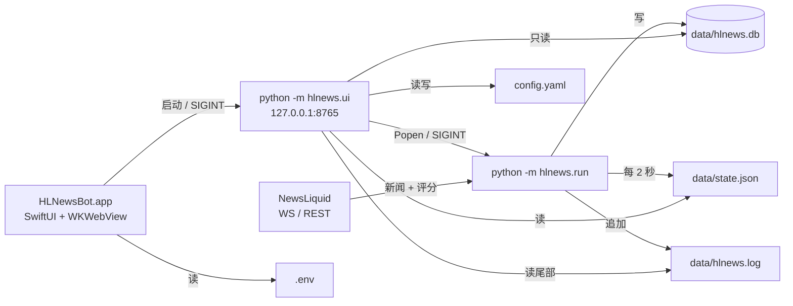

服务对数据库是只读连接（`mode=ro`），所以它和 bot 不会互相写坏；唯一的互斥是"回放"：它和 bot 写同一个库，所以 bot 在跑时回放按钮是禁用的。

## 15. NewsLiquid：接入、套餐与额度、迁移说明

### 它是什么

NewsLiquid 是 6551 团队的新闻交易终端，数据接口叫 OpenNews（`https://ai.6551.io`）。按 [opennews-mcp](https://github.com/6551Team/opennews-mcp) 的 README，来源 85 个，分 6 个引擎：

| 引擎 | 数量 | 内容 | bot 怎么用 |
|---|---|---|---|
| news | 55 | Bloomberg、Reuters、FT、CNBC、CoinDesk、The Block、金十、BWEnews、推特 KOL、Truth Social、美国财政部、欧央行、新闻稿等 | 默认订阅；`nl_news` / `nl_news_stock` 交易 |
| listing | 9 | Binance、Coinbase、OKX、Bybit、Upbit、Bithumb、Robinhood、Hyperliquid、Aster 的上币公告 | 默认订阅；`nl_listing` 只报警 |
| onchain | 2 | Hyperliquid 大额成交、大额持仓 | 默认不订阅 |
| market | 6 | 价格异动、资金费率、跨所费率差、大额爆仓、趋势、持仓量 | 默认不订阅 |
| meme | 1 | 推特上的 meme 币讨论 | 默认不订阅 |
| prediction | 12 | AI 预测与关联信号（聪明钱、巨鲸、内幕模式、结算套利等） | 默认不订阅 |

每条带 `aiRating`（score 0–100、grade、signal long / short / neutral、中英文摘要）；`coins[]` 里每个币有自己的 score / signal / grade，顶层 score 是所有币里的最高分。

### 注册、token、购买

在 app.newsliquid.com/mcp（文档里也写作 6551.io/mcp）：

1. **登录 / 注册**：Google 账号，或者钱包（EVM 钱包如 MetaMask，Solana 钱包如 Phantom；钱包登录要过 Cloudflare 人机验证）。注册时可以填邀请码。没有邮箱密码登录。
2. **创建 token**：同一页面创建（要过人机验证）、复制，放进 `.env` 的 `OPENNEWS_TOKEN`。页面上的"刷新"会换一个新 token，旧的随即失效。
3. **购买**：升级到订阅套餐（按月或按年，按年有折扣），默认用加密货币付款（填邮箱后跳到付款页），也可以取消勾选，改用页面给出的付款二维码 / 链接；或者一次性购买积分（1 USDT = 500 积分，买的积分不过期）；也可以兑换礼品卡。
4. **看用量**：同一页面有额度卡片（套餐积分及重置日期、免费每日额度、购买的积分）、调用日志（每次调用的时间、接口、参数、扣了多少）、计费规则（每个接口怎么扣），以及订单和发票。

### 套餐与额度

创始人 2026-03-10 公布的价格（以 MCP 页面为准）：

| 套餐 | 价格 | 额度 | 建议配置 |
|---|---|---|---|
| Free | 0 | 每天 100 条 | 只够验证：`transport: rest`、`poll_s: 900` |
| Plus | 1.9U | 2 万条 | `transport: rest`、`poll_s: 180`（约 14,400 次 / 30 天） |
| Pro | 29U | 20 万条 | `transport: rest`、`poll_s: 15`（默认，约 17.3 万次 / 30 天） |
| Max | 99U / 月 | 新闻 + 推特实时 WebSocket | `transport: auto` 或 `ws` |

**额度单位没有公开文档讲清楚。** README 写"每次 REST/MCP 调用消耗 1 个额度"；MCP 页面把额度显示成积分（免费每天 5 积分 ≈ 100 条，1 USDT = 500 积分）；推文也没说 Plus / Pro 是一次性还是按月。上表按"1 次调用 = 1 条"估算。拿到 token 后先跑 10 分钟，到 MCP 页面的调用日志和计费规则核对每次 `news_search` 实际扣多少，再调 `poll_s` 或选套餐。

除了按 `poll_s` 的固定轮询，REST 还有几处额外消耗：突发时多读的分页；等第二来源时的热窗口（5 秒一轮，最长 2 分钟）；宏观发布前后的热窗口（5 秒一轮，5 分钟）；WS 每次（重新）订阅后的一次补漏；WS 在线时每 5 分钟一次抽查（每天 288 次）。额度用完或被限流时，REST 暂停 10 分钟并推一条 `feed` 报警。

### 迁移说明：删掉了什么、换成了什么

| 旧 | 新 |
|---|---|
| Tree of Alpha WebSocket（推特、博客、币安公告） | NewsLiquid news（Twitter/X、BWEnews 等）+ listing |
| 金十 WebSocket / REST | NewsLiquid news 里的 `jin10` 来源 |
| Telegram（Telethon 用户会话） | NewsLiquid news 里的 Telegram 来源 |
| Google News RSS、华尔街见闻、财联社 | 无直接替代（NewsLiquid 不含这三个，见第 12 节） |
| 规则车道（CPI / NFP / FOMC / 黑客 / ETF / 关税 / 特朗普 / 财报 / 行业供给的正则） | NewsLiquid 评分；CPI / NFP 改为直接用 BLS 数字做减法 |
| LLM 慢车道（Anthropic / OpenAI） | 删除（NewsLiquid 本身就是 AI 评分） |
| 可信账号、强出版方（单一来源也可直接交易的白名单） | `rating.require_two_sources_for`（反过来：列出必须二源确认的来源） |
| 行业供给车道（东芝 HDD 案例）、`sectors` 配置 | 删除；同类新闻由 NewsLiquid 标到 `XYZ-WDC` 等标签 |
| 17 个事件类模板 | `macro_cpi`、`macro_nfp`、`listing_hl`、`nl_news`、`nl_news_stock`、`nl_listing` |
| `ticker_aliases`（自由文本 → 合约） | `symbol_map`（只在标签和合约名对不上时用） |
| `data/replay_toshiba.jsonl` | 删除；`data/replay.jsonl` 换成 NewsLiquid 真实条目 |

旧代码和文档在提交 `b5b75c0` 及之前，比如 `git show b5b75c0:hlnews/feeds.py`、`git show b5b75c0:README.md`（原第 15–17 节记录了东芝 HDD、金十协议、财联社签名的实测）。数据库不用迁移：表结构没变，旧行照常显示。

### 实测（2026-10-28）

- 免费热榜接口 `GET /open/free_hot?category=…`（不要 token）取 web3 / macro / ai 三类各 50 条，去重后 118 条：72 条 news 引擎、46 条 meme 引擎；分数 62–85，中位数 72；66 条带 universe 内的币种。
- 股票标签：universe 内 11 只股票的标签出现 123 次，60 次同时带纯代码和 `XYZ-` 前缀，63 次只有 `XYZ-`，没有一次只有纯代码。
- 无 token / 无效 token：REST 401（`missing Authorization header` / `invalid token`），WS 握手 401 `unauthorized`；`auto` 模式依次报 `ws_refused`、`auth_fail`。
- `data/replay.jsonl` 用真实主网价格跑完整管线，结果见第 2 节。
- 有了 token 以后建议第一件事：跑 10 分钟，`select count(*), round(avg(age_s),1) from news where source='newsliquid'` 看条目量和延迟；到 MCP 页面看额度消耗。

---

## 许可与免责

私有仓库，无许可证。这是一个研究工具。所有数字来自公开数据的事后统计，不构成投资建议。永续合约带杠杆，可以亏光保证金。先 paper，再 testnet，再小仓。
